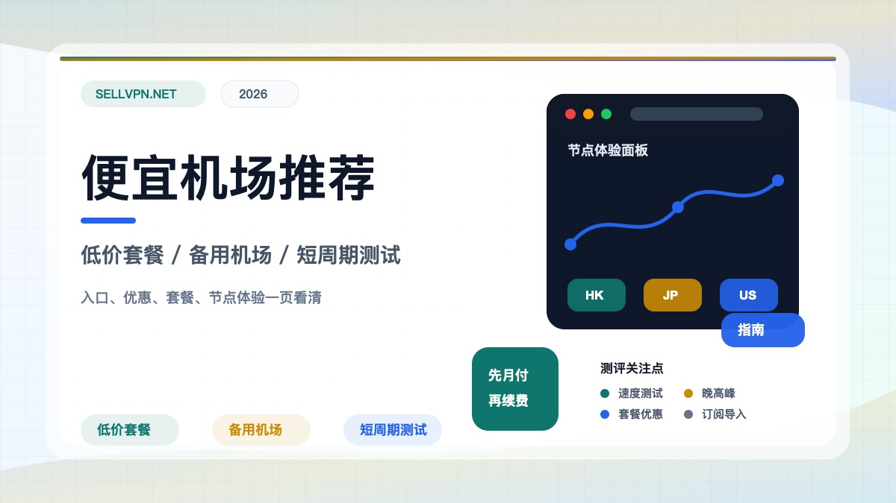

2026 年 11 月 20 日更新候选套餐。网际快车采用 11 月 4 日的商店标价，XXYUN 采用 11 月 8 日的结算预览，其他套餐的资料日期见各家测评。

很多新手搜索“便宜机场推荐”时，容易只看月付价格，忽略了流量、倍率、晚高峰稳定性和售后风险。便宜机场不等于一定不好，但更适合 **短周期测试、轻度使用或备用订阅**，不建议第一次就直接年付。

下表对比一次性流量包、月付套餐与试用档的首次付款金额。价格、优惠码和套餐会变化，最终请以官网结算页为准。

<!-- more -->

## 便宜机场适合哪些人？

便宜机场更适合下面几类用户：

- 每月流量需求不大，主要访问 Google、Telegram、GitHub、ChatGPT
- 已经有主力机场，只想补一个备用订阅
- 想先低成本测试不同机场线路
- 不想一开始投入太高预算
- 只需要偶尔看 YouTube 或查资料

如果你每天都要长时间观看高清视频、使用多个设备、远程办公或频繁访问 AI 工具，更建议优先看 [2026机场推荐排行榜](/posts/vpn-airport-ranking-2026/)，不要只按最低价格选择。

## 低价机场优先看哪些指标？

| 指标 | 为什么重要 | 购买前怎么判断 |
| --- | --- | --- |
| 月付价格 | 决定试错成本 | 优先选择月付或体验包 |
| 套餐流量 | 影响实际可用时长 | 看清每月重置还是一次性流量 |
| 节点倍率 | 影响真实消耗 | 高倍率节点会更快用完流量 |
| 晚高峰表现 | 决定能否长期用 | 晚上 20:00-24:00 重点测试 |
| 客户端支持 | 决定新手配置难度 | 是否支持 Clash、Shadowrocket、Stash |
| 售后渠道 | 出问题能否处理 | 是否有工单、公告或群组 |

## 2026低价与备用机场参考

下面按“低成本测试”和“备用订阅”两个方向整理。这里不做永久稳定承诺，建议先短周期购买。

| 机场类型 | 可优先对比 | 参考说明 |
| --- | --- | --- |
| 按量备用 | [网际快车](/posts/wangjikuai-review-2026/) | 20GB 整包 ¥6.80，100GB 整包 ¥24，商店注明用完为止 |
| 低价月付 | [XXYUN](/posts/xxyun-review-2026/) | 初级档 ¥9.99/月 100GB，新客首单预览 ¥8.99，使用官方客户端 |
| 其他低价选择 | 冲上云霄、99吧 | 适合预算有限的新手，重点看晚高峰和节点可用性 |
| 备用测试 | 快狸、[速界](/posts/sujie-review-2026/)、Soso云、光速云、[COCODUCK](/posts/cocoduck-review-2026/) | 速界 50GB 试用档 ¥15/月，常规 120GB 档 ¥25/月。COCODUCK 的 100GB 档为 ¥17/月 |
| 常规月付 | 全球云、u1s1、[唯兔云](/posts/weituyun/) | 全球云和 u1s1 的 120GB 档均为 ¥20/月，续费优惠待核。唯兔云常规 150GB 档 ¥19.90/月，¥14.90 的 100GB 档是节日套餐 |
| 中等流量 | 瞬云、EdgenNova | 适合日常使用和多场景对比 |

详细价格和优惠码可以查看：

- [VPN和机场有什么区别？2026新手科学上网选择指南](/blog/vpn-vs-airport/)
- [2026年7月机场推荐排行榜](/posts/vpn-airport-ranking-2026/)
- [各大机场优惠码汇总](/posts/airport-coupon-table/)
- [2026机场官网入口汇总](/posts/airport-official-links-2026/)

## 低价机场怎么搭配更稳？

如果你只是轻度使用，可以选择一个低价月付机场作为主力，再准备一个低价备用机场。

如果你对稳定性要求更高，建议使用：

- 一个稳定主力机场：用于日常工作、ChatGPT、GitHub、视频
- 一个低价备用机场：用于主力维护或节点波动时切换
- 一个短周期测试订阅：用于观察新机场表现

这样比只买一个年付机场更灵活，也更容易规避单点风险。

## 便宜机场常见坑

### 1. 看起来便宜，但流量很少

有些套餐月付价格低，但只有很少流量。看视频、更新软件或多设备共享时，很快就会用完。

### 2. 节点倍率不清楚

部分机场热门节点可能是 2 倍、3 倍甚至更高倍率。购买前要确认倍率规则，否则实际可用流量会比标称少很多。

### 3. 年付看似划算，但风险更高

低价年付的单月成本很低，但机场服务会受线路、支付、域名和运营状态影响。新手第一次购买，建议先月付。

### 4. 只看测速截图

测速截图只能说明某个时间点的速度，不能代表长期稳定。更重要的是晚高峰、周末和常用节点的连续使用体验。

## 新手低价机场购买流程

1. 先看本站测评和优惠码页
2. 选择月付、体验包或小流量套餐
3. 下单前确认优惠码是否生效
4. 按所选套餐安装官方客户端，或把兼容的订阅导入已有客户端
5. 测试香港、日本、新加坡、美国等常用节点
6. 晚高峰重复测试一次
7. 稳定后再考虑续费或升级套餐

## 便宜机场 FAQ

### 便宜机场可以长期用吗？

可以观察，但不建议一开始就长期付款。便宜机场更适合先用月付测试，确认本地网络体验后再考虑续费。

### 便宜机场可以看 YouTube 吗？

通常可以访问 YouTube，但能否稳定 1080P 或 4K，要看节点带宽、晚高峰负载和本地宽带线路。

### 便宜机场可以用 ChatGPT 吗？

需要按节点实际测试。建议优先测试美国、日本、新加坡等节点，并观察登录、对话和连续使用是否稳定。

### 低价机场和高端机场怎么选？

轻度用户先低价月付即可；工作、AI、流媒体和多设备用户，更适合选择稳定性更好的中高价套餐，同时保留备用机场。

## 总结

2026 年选择便宜机场，核心不是找到最低价，而是用最低试错成本找到适合自己网络环境的方案。低价机场适合新手入门和备用场景，但购买前一定要确认流量、倍率、节点、客户端和优惠码状态。

如果你还没有明确候选，建议先看 [机场推荐排行榜](/posts/vpn-airport-ranking-2026/)，再用 [机场优惠码汇总](/posts/airport-coupon-table/) 做购买前核对。
