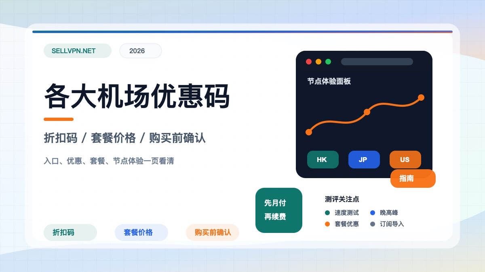

本文的预算比较整理于 2026 年 7 月 20 日。11 月 20 日更新了网际快车的按量包、XXYUN 的首单报价和各品牌的验券条件。

想找便宜机场，不应该只比较首页上的最低月费；想找优惠机场，也不能看到优惠码就直接购买。真正影响使用成本的还有套餐周期、可用流量、节点倍率、设备数量和优惠适用范围。

本文从省钱角度讲清楚 **机场 VPN、便宜机场、优惠机场和优惠码**之间的关系，并整理几种常见预算下的选择方法。文中的“机场 VPN”是常见搜索说法，机场订阅与传统商业 VPN 并不是同一种服务；第一次接触的读者可以先看 [VPN和机场有什么区别](/blog/vpn-vs-airport/)。

套餐和活动可能随时调整，文中价格与优惠信息用于筛选，最终请以官网套餐页和订单结算页为准。

<!-- more -->

## 便宜机场和优惠机场有什么区别？

**便宜机场**通常是套餐原价较低，适合预算有限、轻度使用或准备备用订阅的用户。**优惠机场**则是通过优惠码、新人活动或邀请入口降低实付价格，原价不一定最低。

例如，一个月付 9.9 元的套餐看起来很便宜，但可能只有较少流量；另一个月付 20 元的套餐如果提供永久 8 折，折后约为 16 元，流量和节点却可能更多。因此，判断是否划算至少要比较以下四项：

- 每月或每个计费周期的实付价格
- 套餐包含的流量与节点倍率
- 优惠码可以使用几次
- 是否必须购买季付、半年付或年付

如果只是偶尔浏览网页，低价套餐通常够用；如果需要观看视频、访问 AI 工具或进行跨境办公，则应优先考虑晚高峰稳定性，而不是单纯追求最低价。

## 2026便宜机场与优惠机场对比

先按公开套餐和优惠信息缩小范围。点击机场名称可通过本站邀请链接进入。通过这些链接购买，本站可能获得佣金。[联盟披露](/affiliate-disclosure/)

| 机场 | 参考入门价 | 优惠码 | 优惠说明 | 更适合 |
| --- | --- | --- | --- | --- |
| [网际快车](https://ygduea.xn--66tw07h.com) | ¥6.80/20GB 或 ¥24/100GB，整包不限时 | 暂无公开码 | [11 月 4 日商店标价](/posts/wangjikuai-review-2026/) | 用量不固定，想小额购买备用流量 |
| [XXYUN](https://www.xx-yun.com/?code=lZlwmBj9) | ¥9.99/月 100GB | `xxyun` | 11 月 8 日新人月付预览 ¥8.99，使用官方客户端。[套餐说明](/posts/xxyun-review-2026/) | 每个月都有用量，想先买一个周期 |
| [冲上云霄](https://cpdd.one/?r=16656) | ¥5/月80GB | 暂无公开码 | 以官网活动为准 | 低价入门、短期使用 |
| [99吧](https://99ba.net/#/register?code=bWUJsTG0) | ¥9.9/99GB | 暂无公开码 | 以官网活动为准 | 低价备用订阅 |
| [快狸](https://wudao01.kuailiaff.com/#/?code=ngH6LgR6) | ¥15/月 50GB | `sellvpn` | [11 月 14 日月狸月付报价 ¥12](/posts/kuaili-review-2026/#coupon-evidence) | 想低价月付试用的用户 |
| [EdgenNova](https://sell.edgenovaaff.com/#/register?code=0hcQ2OF8) | ¥15/月 50GB 体验，¥25/月 120GB 标准 | `SE888` | 历史新人活动，当前结算待核 | 先体验再决定是否续费 |
| [光速云](https://wudaogang.gsyaff.com/#/?code=3t2CE1r6) | ¥17/月 110GB | `AMM` | 历史新人活动，当前结算待核 | 日常使用、线路对比 |
| [全球云](https://sellvpn.gcvipaff.cc/#/?code=eZQbQpGe) | ¥20/月 120GB | `qq88` | 8 月记录称长期 8 折，续费报价待核 | 需要比较按月流量和续费成本 |
| [u1s1](https://sellvpn.vipaff.cc/#/?code=efD0Kxqq) | ¥20/月 120GB | `U1S1` | 8 月记录称长期 8 折，续费报价待核 | 日常主力或备用机场 |

更多套餐的适用条件和核对日期见[机场优惠码汇总](/posts/airport-coupon-table/)。对比各家的流量和付款周期，可查看[机场套餐对比](/posts/vpn-airport-ranking-2026/)。

## 不同预算怎么选机场 VPN？

### 每月10元以内：优先满足基础需求

网际快车 11 月 4 日的 20GB 整包标价 ¥6.80，可以跨月用完。XXYUN 初级档每月提供 100GB，11 月 8 日标价 ¥9.99/月，新人码生效时预览为 ¥8.99。前者按实际扣量消耗，后者按月购买并使用官方客户端。其他低价选择还包括冲上云霄和 99吧。

不要只看“最低几元”这样的宣传。部分低价套餐在节点数量、设备数或可用流量上会有限制，选择时应打开完整套餐说明。

### 每月10至20元：兼顾价格和流量

以快狸 11 月 14 日的 `sellvpn` 结算记录为例，月狸 50GB 单买一个月应付 ¥12。森狸年付折合每月 ¥8，但首次要付 ¥96，每 30 天提供 30GB。若这次预算只有 ¥20，只有月狸的这笔报价在预算内。

### 每月 20 元左右怎么估算续费

全球云和 u1s1 的入门档在 8 月均标价 ¥20/月，每月 120GB。两家历史活动都写过长期八折，目前缺少续费订单验证。若预算依赖折扣，先按每月 ¥20 留足费用，再看自己续费订单上的减免。[全球云套餐记录](/posts/quanqiuyun/) · [u1s1 套餐记录](/posts/u1s1-review-2026/)

## 机场优惠码怎么使用？

大多数机场的优惠码使用流程相近：

1. 从机场官网或优惠入口注册账号。
2. 登录用户面板并选择套餐。
3. 进入订单结算页，找到“优惠码”“折扣码”或“Coupon”。
4. 输入优惠码，点击应用或验证。
5. 检查优惠金额和最终实付价格。
6. 确认折扣已经生效后再完成付款。

优惠码无法使用时，先检查有没有多余空格，再确认该优惠是否仅限新用户、首次购买或指定套餐。如果价格没有变化，不要直接支付，可以换一个短周期套餐或等待新的活动。

## 怎么计算哪个机场更便宜？

比较便宜机场时，可以用一个简单思路：

**实际月成本 = 付款金额 ÷ 套餐有效月数**

如果还要比较流量价值，可以继续计算：

**每GB成本 = 实付金额 ÷ 可用流量**

不过，每 GB 成本只适合做初步筛选。节点倍率会让实际流量消耗加快，线路质量也会直接影响体验。一个价格很低但晚高峰无法稳定连接的套餐，并不是真正省钱。

购买前建议依次核对：套餐周期、每月流量、节点倍率、在线设备数、退款规则和客服渠道。还可以参考 [机场测速方法](/posts/airport-speed-test-method-2026/) 和 [机场避坑防跑路指南](/posts/airport-risk-checklist-2026/)。

## 选择优惠机场要避开的误区

### 看到年付低价就直接购买

年付换算后的月均价格通常更低，但机场线路和运营情况可能变化。第一次使用某个机场时，优先选择月付或体验包，确认适合自己的网络环境后再续费。

### 只看测速截图

测速结果会受到测试时间、地区、宽带运营商和节点负载影响。比起单次峰值速度，晚高峰丢包、常用网站访问和视频加载体验更有参考价值。

### 把邀请链接当成优惠码

邀请链接通常用于注册和来源追踪，不代表结算时一定自动打折。优惠码则需要在订单页验证。付款前应以最终金额为准。

### 只准备一个机场

经常用于工作或学习的用户，可以准备主力机场和低价备用机场。主力订阅负责稳定性，备用订阅在入口或线路临时异常时使用。

## 常见问题

### 机场 VPN 是越便宜越好吗？

不是。价格只是筛选条件之一，节点稳定性、倍率、设备限制和售后同样重要。轻度用户可以优先考虑便宜机场，高频用户更适合在价格和稳定性之间取平衡。

### 哪些优惠码可以长期使用？

全球云 `qq88` 和 u1s1 `U1S1` 在历史活动资料中标注为长期优惠，续费前仍应检查当期规则。快狸 `sellvpn` 有三项下单前的八折报价，续费资格、可用次数和截止日期仍待核实。[快狸结算记录](/posts/kuaili-review-2026/#coupon-evidence)

### 没有优惠码的机场能买吗？

可以。没有公开优惠码不代表套餐不划算，有些便宜机场直接提供低价套餐或自动活动价。重点是比较最终实付金额、流量和使用限制。

### 新手应该买月付还是年付？

第一次购买建议月付或体验包。至少测试一次工作日晚高峰和周末常用时段，确认订阅更新、客户端导入和常用节点都正常后，再考虑更长周期。

## 总结

找便宜机场时，应先看原价、流量和套餐周期；找优惠机场时，应进一步确认优惠码的折扣力度、使用次数和适用套餐。真正省钱的顺序是：**先选符合需求的套餐，再应用优惠码，确认实付金额后短周期测试。**

如果还没有明确目标，可以先按预算筛选两到三个机场 VPN，再分别测试晚高峰、常用节点和客户端兼容性。不要为了最低月均价贸然年付，也不要把单次测速结果当成长期体验。

