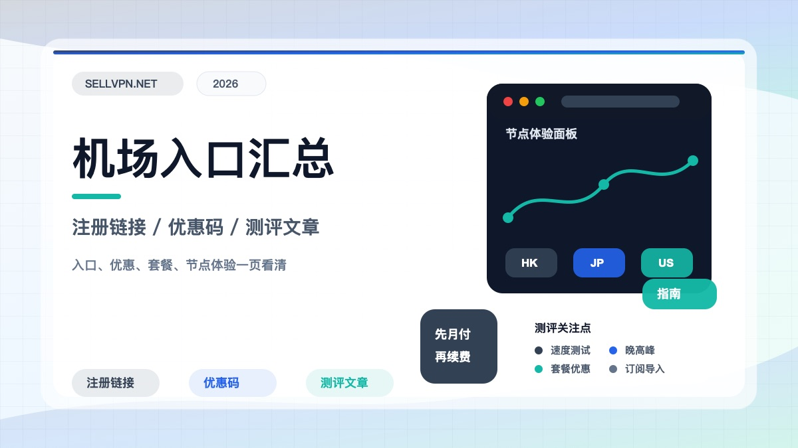

11 月 20 日更新。各家的套餐资料见对应独立页，安迪、宝云等 10 家的[邀请注册链接与文章](#更多机场的独立文章)列在第二张表。套餐核对时间与入口检查时间分别列示。

> **联盟披露：** 本文部分注册入口包含推广参数。你通过这些链接注册或购买后，本站可能获得佣金。佣金关系不构成性能背书；价格、优惠与服务状态请以商家结算页为准。

这里集中列出 **33 家机场**的官网或注册入口、优惠码和单项测评。打开入口后，先确认当前套餐名称、付款周期和结算金额。遇到线路检测页时，可按页面指引选择可访问线路。

<!-- more -->

## 2026机场官网入口与优惠码汇总

11 月 19–20 日，我们用浏览器核对了与「机场测试」共同收录的 28 家。25 家可在注册表单看到与入口一致的邀请码。网际快车选择线路后会带上专属渠道参数。无忧链接保留邀请码进入人工验证码页，注册表单仍待核对。山水云提供普通注册页，邀请码栏为空。此次核对止于付款和创建账户之前。

| 机场名称 | 官网入口 | 优惠码 | 折扣说明 | 参考入门价 | 测评文章 |
| --- | --- | --- | --- | --- | --- |
| 网际快车 | [点击进入](https://YGDUEA.快车.com) | 暂无公开码 | 当前活动待核实 | ¥6.80/20GB 不限时 | [网际快车测评](/posts/wangjikuai-review-2026/) |
| XXYUN机场 | [点击进入](https://www.xx-yun.com/?code=lZlwmBj9) | `xxyun` | 11 月 8 日新人码报价 ¥8.99 | ¥9.99/月 100GB | [XXYUN机场测评](/posts/xxyun-review-2026/) |
| 快狸机场 | [邀请入口](https://wudao01.kuailiaff.com/#/?code=ngH6LgR6) | `sellvpn` | 11 月 14 日月狸月付报价 ¥12，续费待核实 | ¥15/月 50GB | [快狸结算截图](/posts/kuaili-review-2026/#coupon-evidence) |
| 光速云机场 | [点击进入](https://wudaogang.gsyaff.com/#/?code=3t2CE1r6) | `AMM` | 8 月活动资料，首单 8 折待验 | ¥17/月 110GB | [光速云机场测评](/posts/guangsucloud-review-2026/) |
| 速界机场 | [点击进入](https://wudaogang.speedworldaff.com/#/register?code=ITNrq6EJ) | `sujie888` | 8 月活动资料，首单 8 折待验 | ¥15/月 50GB 试用，常规 ¥25/月 120GB | [速界机场测评](/posts/sujie-review-2026/) |
| EdgenNova（边缘节点） | [点击进入](https://sell.edgenovaaff.com/#/register?code=0hcQ2OF8) | `SE888` | 8 月推广标注首单 7.8 折，待验 | ¥15/50GB 体验，常规 ¥25/月 | [EdgenNova机场测评](/posts/edgenova-review-2026/) |
| 瞬云机场 | [点击进入](https://ddd.jichang.best/#/register?code=BBP8rqS8) | `20off` | 新人首次8折 | ¥20/月160GB | [瞬云机场测评](/article/shunyun/) |
| 全球云机场 | [点击进入](https://sellvpn.gcvipaff.cc/#/?code=eZQbQpGe) | `qq88` | 8 月活动资料标注长期 8 折，续费待验 | ¥20/月 120GB | [全球云机场测评](/posts/quanqiuyun/) |
| 唯兔云机场 | [点击进入](https://sellvpn.v2cvipaff.cc/#/?code=hr6gESut) | `rabbit` | 8 月活动资料，新人 9 折待验 | 常规 ¥19.90/月 150GB，节日档 ¥14.90/月 100GB | [唯兔云机场测评](/posts/weituyun/) |
| u1s1机场 | [点击进入](https://sellvpn.vipaff.cc/#/?code=efD0Kxqq) | `U1S1` | 8 月活动资料标注长期 8 折，续费待验 | ¥20/月 120GB | [u1s1机场测评](/posts/u1s1-review-2026/) |
| 无忧链接机场 | [点击进入](https://wudaogang.worryfreeaff.com/#/?code=vKiprwPh) | `wuyou666` | 历史资料：新人 6.8 折，结算待核对 | ¥19/月 100GB | [无忧链接机场测评](/posts/wuyou-review-2026/) |
| Firefly 机场 | [点击进入](https://wudaogang0.fireflyaff.com/#/?code=PZlWmWbX) | `firefly` | 历史资料：新人 8 折，结算待核对 | ¥25/月 150GB | [Firefly 机场测评](/posts/firefly-review-2026/) |
| 冲上云霄机场 | [点击进入](https://cpdd.one/?r=16656) | 暂无公开优惠码 | 以官网活动为准 | ¥5/月80GB | [冲上云霄机场测评](/posts/chongshangyunxiao/) |
| cocoduck机场 | [点击进入](https://www.cocoduck.live/auth/register?code=cdb08a39e6) | 暂无公开优惠码 | 以官网活动为准 | ¥17/月 100GB | [cocoduck机场测评](/posts/cocoduck-review-2026/) |
| 99吧机场 | [点击进入](https://99ba.net/#/register?code=bWUJsTG0) | 暂无公开优惠码 | 以官网活动为准 | 以官网套餐为准 | [99吧机场测评](/posts/99ba-review-2026/) |
| 闪电鼠 | [打开入口](https://wudaogang.shandianshuaff.com/#/?code=oE1NhRah) | `sd88` | 部分套餐 7 折，周期以结算为准 | ¥15/月 50GB | [闪电鼠测评](/posts/shandianshu-review-2026/) |
| 大佬云 | [打开入口](https://wudaogang0.dalaoyunaff.com/#/?code=oP4w0Bbh) | `dly88` | 部分套餐 7 折，周期以结算为准 | ¥15/月 50GB | [大佬云测评](/posts/dalaoyun-review-2026/) |
| 榴莲云 | [打开入口](https://wudaogang.liulianyunaff.com/#/?code=qrZTGPlG) | `ll88` | 部分套餐 7 折 | ¥15/月 50GB | [榴莲云测评](/posts/liulianyun-review-2026/) |
| 环球梯 | [打开入口](https://wudaogang.huanqiutiaff.com/#/?code=vRWVDhFs) | `HQ66` | 部分套餐 8 折，公告截至 11 月 30 日且限量 | ¥15/月 60GB | [环球梯测评](/posts/huanqiuti-review-2026/) |
| 山水云 | [普通注册入口](https://47.86.34.254:5210/#/register) | `2026888` | 后台标注长期 8 折 | ¥12/月 100GB | [山水云测评](/posts/shanshuiyun-review-2026/) |
| 云界线 | [打开入口](https://wudaogang0.yunjiexianaff.com/#/?code=C5fSiHQU) | `yjx888` | 指定常规套餐新客首单 7 折 | ¥19.88/月 130GB | [云界线测评](/posts/yunjiexian-review-2026/) |
| 神行加速 | [打开入口](https://wudaogang0.shenxingaff.com/#/?code=V3kBm6Cv) | `sx0077` | 指定常规套餐新客 7 折 | ¥19.88/月 100GB | [神行加速测评](/posts/shenxing-review-2026/) |
| 光年梯 | [邀请入口](https://sellvpn.gntvipaff.cc/#/?code=btzIT9Fo) | `sell75` | 11 月 12 日入门月付首单报价 ¥13.50 | ¥18/月 110GB | [光年梯测评](/posts/guangnianti-review-2026/) |

## 更多机场的独立文章

以下 10 家的注册链接均已在浏览器打开，注册表单显示了对应的邀请码。优惠码填在购买套餐的结算页，适用条件见各篇文章。

| 独立文章 | 邀请入口 | 套餐资料 |
| --- | --- | --- |
| [安迪（AnDy Cloud）](/posts/andy-review-2026/) | [邀请注册](https://se.andygg.com/#/register?code=lAiIqFaC) | 100GB 月付和 1,000GB 一次性包的报价 |
| [宝云](/posts/baoyun-review-2026/) | [邀请注册](https://141.11.77.85:8888/#/register?code=nOhXZZTH) | 福宝 200GB 月付的标价和验券金额 |
| [极速 Cloud](/posts/jisucloud-review-2026/) | [邀请注册](https://se.jisu518.com/#/register?code=IJv17tXC) | 新人 200GB 套餐及其优惠条件 |
| [九云](/posts/jiuyun-review-2026/) | [邀请注册](https://216.236.63.122/#/register?invite_code=ME4z89ej) | 150GB 月付的券后价与 500GB 包的期限 |
| [锦云](/posts/jinyun-review-2026/) | [邀请注册](https://216.236.63.115/#/register?code=zWJ7xL3p) | 50GB 月付的验券记录 |
| [鲤云](/posts/liyun-review-2026/) | [邀请注册](https://103.73.220.148:8888/app.html#/register?code=HrOwGxY9) | 小鲤月付价格及折扣公告的适用条件 |
| [熊猫 Cloud](/posts/pandacloud-review-2026/) | [邀请注册](https://103.73.220.147:8888/#/register?code=L9ROkS1X) | 300GB 月付和 365 天流量包 |
| [秒秒云](/posts/miaomiaoyun-review-2026/) | [邀请注册](https://141.11.77.26/#/register?code=L09kqV2V) | 探花月付、特惠季付与福气包的区别 |
| [稳连云](/posts/wenlianyun-review-2026/) | [邀请注册](https://w2.wenliandl.com/#/register?invite_code=lZq8qX8V) | 通过验券的套餐和两款无法用券的 365 天包 |
| [一号 One](/posts/yihao-one-review-2026/) | [邀请注册](https://47.243.112.133:5111/#/register?code=QJYEY3Rx) | 100GB 月付与 128GB 特惠季付的付款门槛 |

## 怎么使用这份入口表？

### 1. 先确认官网是否能打开

机场入口可能会因为域名调整、维护或地区网络原因临时不可用。如果某个入口打不开，可以先稍后重试，或者优先查看本站对应测评页中的备用说明。

### 2. 下单前确认优惠码

优惠码可能存在新人限制、次数限制、套餐限制或有效期限制。复制优惠码后，请在结算页确认折扣金额已经变化，再完成支付。

### 3. 新手先买短周期套餐

不同地区宽带体验会有差异。第一次购买某家机场，建议先选择月付、体验包或小流量套餐，测试常用节点、常用设备和晚高峰速度后再续费。

### 4. 主力机场和备用机场分开

如果你每天都要使用 ChatGPT、GitHub、Google、Telegram 或流媒体服务，建议准备一个主力机场和一个备用机场。主力看长期稳定，备用看价格和入口可用性。

## 按需求快速选择

| 需求 | 可以优先对比 |
| --- | --- |
| 想按券后价比较月付 | 闪电鼠、大佬云、榴莲云、环球梯、山水云、云界线、神行加速 |
| 想找主力机场 | 瞬云、全球云、EdgenNova、唯兔云 |
| 想找备用机场 | 网际快车、XXYUN、快狸、速界、光速云、99吧、冲上云霄、cocoduck、Firefly |
| 想看流媒体体验 | 唯兔云、EdgenNova、全球云、瞬云 |
| 想查长期折扣记录 | 全球云、u1s1（8 月活动资料，续费待验） |

## 新手购买机场前注意事项

购买前建议重点确认这些信息：

- 是否支持你的设备系统，例如 Windows、macOS、iOS、Android
- 是否支持常用客户端，例如 Clash Verge、Clash Mi、Shadowrocket、Stash、V2RayN、sing-box
- 是否支持 ChatGPT、Netflix、Disney+、TikTok、YouTube 等常用服务
- 套餐流量是每月重置还是一次性流量
- 是否有节点倍率，热门节点是否消耗更多流量
- 是否限制设备数量或在线连接数
- 官网公告、客服渠道和教程是否持续更新

## 推荐阅读

- [2026 机场推荐与套餐对比](/posts/vpn-airport-ranking-2026/)
- [2026 机场优惠码汇总](/posts/airport-coupon-table/)
- [2026便宜机场推荐：低价机场与备用机场选购指南](/posts/cheap-airport-ranking-2026/)
- [2026 ChatGPT机场推荐：AI工具可用节点测试指南](/posts/chatgpt-airport-ranking-2026/)
- [2026流媒体机场推荐：Netflix、YouTube、TikTok解锁测试指南](/posts/streaming-airport-ranking-2026/)
- [机场防跑路与避坑指南](/posts/airport-risk-checklist-2026/)
- [快狸机场测评指南](/posts/kuaili-review-2026/)
- [速界机场测评指南](/posts/sujie-review-2026/)
- [EdgenNova机场测评指南](/posts/edgenova-review-2026/)
- [光速云机场测评指南](/posts/guangsucloud-review-2026/)
- [Clash Mi 使用教程：下载安装、订阅导入与常见问题](/blog/clashmi/)
