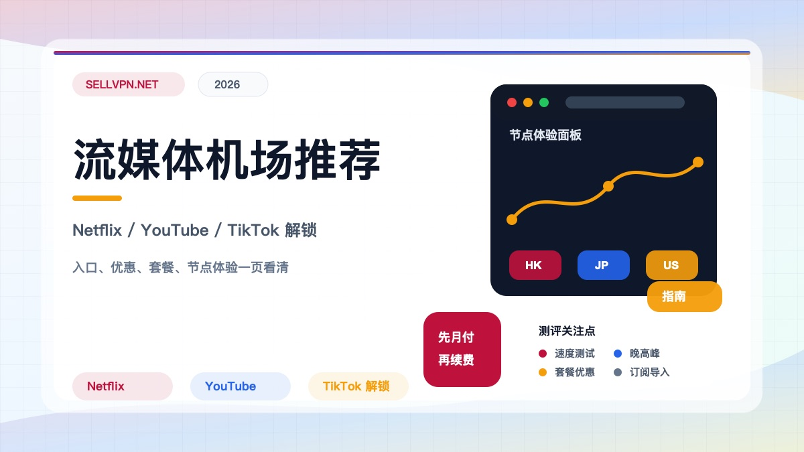

本文最初整理于 2026 年 7 月 18 日，11 月 20 日补入网际快车的日享限额和 XXYUN 的平台检测记录。

如果你买机场主要为了看 YouTube、Netflix、Disney+、TikTok 或其他海外流媒体，不能只看下载速度。流媒体体验还受节点地区、IP质量、平台风控、晚高峰负载和客户端规则影响。

本文整理一份 2026 流媒体机场选购与测试指南，帮助你判断机场是否适合视频观看和影音娱乐。

<!-- more -->

## 流媒体机场要看哪些指标？

| 指标 | 说明 |
| --- | --- |
| 节点地区 | 香港、日本、新加坡、美国、台湾是常见测试地区 |
| 解锁状态 | Netflix、Disney+、TikTok 需要按节点实际测试 |
| 带宽表现 | 1080P、4K、拖动进度条是否稳定 |
| 晚高峰速度 | 晚上和周末更能反映真实体验 |
| 流量倍率 | 视频消耗大，高倍率节点会更快用完套餐 |
| 备用节点 | 某个地区失效时，需要能切换其他节点 |

## YouTube、Netflix、TikTok测试重点

### YouTube

YouTube 更适合用来测试基础速度。建议测试：

- 1080P 是否秒开
- 4K 是否需要缓冲
- 拖动进度条是否卡顿
- 晚高峰播放是否掉速

### Netflix / Disney+

Netflix 和 Disney+ 更看重解锁状态。建议打开对应平台，确认：

- 是否能登录
- 是否显示对应地区片库
- 是否可以正常播放
- 是否中途报代理错误

### TikTok

TikTok 对节点地区和客户端环境更敏感。即使节点速度很快，也可能因为账号、设备、SIM 卡或地区策略导致体验不稳定。

## 站内可优先对比的机场文章

选视频套餐时可先对比流量的计费周期，再用自己的设备测试常看的平台。11 月有两份记录可以用来估算自己的视频用量。

以下两家机场的名称链接为本站邀请入口。通过这些链接购买，本站可能获得佣金。[联盟披露](/affiliate-disclosure/)

- [网际快车](https://ygduea.xn--66tw07h.com)在 11 月 4 日的商店列有 ¥6.80 的 20GB 按量包，以及 ¥28 的 30 天日享包。后者每天重置 60GB。如果当天集中看视频，用 5 倍线路传输 12GB 就可能达到当天额度。[网际快车套餐与节点倍率](/posts/wangjikuai-review-2026/)
- [XXYUN](https://www.xx-yun.com/?code=lZlwmBj9) 的 100GB 月付 11 月新客验券报价为 ¥8.99。惠州移动用户提交的截图中，42 条地区线路有 39 条显示 Netflix 可用。平台探测没有给出特定片库的播放时长与清晰度。还需确认常用设备支持官方客户端或指定软路由插件。[XXYUN 套餐与平台检测记录](/posts/xxyun-review-2026/)

其他机场的套餐、客户端和线路资料也可逐家查阅。

- [SSONE机场测评](/posts/ssone/)
- [唯兔云机场测评](/posts/weituyun/)
- [EdgenNova机场测评](/posts/edgenova-review-2026/)
- [全球云机场测评](/posts/quanqiuyun/)
- [cocoduck机场测评](/posts/cocoduck-review-2026/)

需要查看更多品牌，可继续阅读[机场套餐对比](/posts/vpn-airport-ranking-2026/)。初次接触订阅服务，可先看[VPN 和机场的区别](/blog/vpn-vs-airport/)。

## 流媒体机场购买前提醒

### 1. 不要只看“支持解锁”

流媒体解锁会随平台策略变化。今天可用，不代表永久可用。建议购买后立即测试常用平台和常用地区。

### 2. 视频用户要看流量

长时间看视频很耗流量。如果套餐只有几十 GB，可能几天就用完。重度视频用户建议选择更高流量套餐，或者准备按量套餐作为补充。

### 3. 晚高峰比白天更重要

白天测速快，不代表晚上也快。建议在 20:00-24:00 测试 1080P、4K 和拖动播放。

### 4. 保留备用机场

流媒体平台风控变化快，某个节点失效很常见。长期看 Netflix、Disney+ 或 TikTok 的用户，最好准备一个备用订阅。

## 流媒体机场 FAQ

### 机场能保证永久解锁 Netflix 吗？

不能。流媒体解锁会受平台风控和节点 IP 状态影响，没有任何机场能保证永久可用。

### 看 YouTube 需要多大流量？

轻度观看可以选择 100GB 左右套餐；如果经常看 4K，建议选择 200GB 以上或更高流量套餐。

### 香港节点看视频一定最快吗？

不一定。香港节点延迟低，但晚高峰负载可能更高。日本、新加坡、美国节点也值得测试。

### 手机端和电脑端体验会一样吗？

不一定。手机端还受 App 地区、账号、SIM 卡、系统代理方式影响。建议分别测试手机和电脑。

## 总结

2026 年选择流媒体机场，要把“速度、解锁、流量、倍率、晚高峰”一起看。新手可以先从站内测评完整的机场里挑选候选，再用短周期套餐测试常用平台。

下单前建议先看 [各大机场优惠码](/posts/airport-coupon-table/)，确认折扣生效后再付款。
