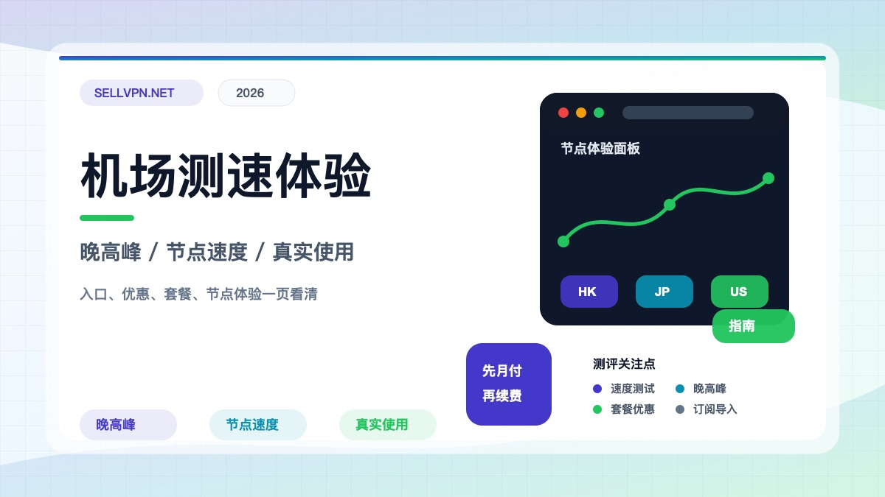

本文最初整理于 2026 年 4 月。11 月 19 日更新了候选套餐和客户端要求。网际快车的商店标价采于 11 月 4 日，XXYUN 采于 11 月 8 日，光年梯采于 11 月 12 日。

> **联盟披露：** 本文部分注册入口包含推广参数。你通过这些链接注册或购买后，本站可能获得佣金。佣金关系不构成性能背书；价格、优惠与服务状态请以商家结算页为准。

本文根据服务商页面和公开资料整理候选项，帮助你缩小范围后再按本地网络进行短周期测试。

> **证据说明：** 当前未在同一地区、运营商、客户端和时段完成这些服务的统一复测。下文涉及速度、稳定性和解锁能力的描述均为待核验的资料线索，不应视为本站实测结论。

---

## 🧠 2026机场推荐概览

在选择适合的机场时，可先按公开套餐与服务定位关注以下候选项：

- **按量备用**优先看网际快车，适合想先付小额费用、按实际用量挑流量包的人。[套餐资料](#_3-网际快车机场)
- **低价月付**可比较 XXYUN，100GB 初级档标价 ¥9.99/月，新客首单报价为 ¥8.99。[套餐资料](#_5-xxyun机场)
- 🆕 **主力候选**：瞬云（性能待本地复测）
- 🛣️ **专线资料候选**：全球云 / 光年梯（线路口径待核对）
- 🎬 **流媒体候选**：SSONE（解锁状态需按节点复测）
- 🆕 **新手候选**：Flybit（先核对试用和客户端说明）

---

## 🚀 为什么选择机场而非传统VPN？

机场与传统 VPN 的产品形态不同，部分服务可能提供以下特点：

- ✔ **多地区节点**：节点数量和覆盖范围以各服务商后台为准
- ✔ **中转或专线口径**：是否更快要在本地网络实际测试
- ✔ **流媒体节点**：解锁状态会随平台风控和节点 IP 变化
- ✔ **灵活的价格策略**：价格多样化，适应不同需求

---

## 📊 本地复测的关键维度

购买短周期套餐后，建议记录以下指标：

- **稳定性**：晚高峰时的网络稳定性
- **实际速度**：4K视频播放、下载速度等
- **节点质量**：是否为专线，节点的响应速度
- **流媒体支持**：是否能解锁主流视频平台（如Netflix、Disney+）
- **性价比**：价格与表现的平衡

---

## 🏆 机场服务候选（性能待复测）

### 1. **网际快车机场** {#_3-网际快车机场}

偶尔才用备用线路，可以先比较网际快车的按量包。11 月 4 日商店把 20GB 列为 ¥6.80，一次性付款，用完为止。100GB 整包标价 ¥24。若每天用量比较固定，还可比较 ¥28 的 30 天日享包，每日 60GB，凌晨重置。[网际快车套餐资料](/posts/wangjikuai-review-2026/) · [网际快车邀请入口](https://ygduea.xn--66tw07h.com)

---

## 🏆 更多机场候选（性能待复测）

### 2. **XXYUN机场** {#_5-xxyun机场}

11 月 8 日的 XXYUN 初级档每月 100GB，月付标价 ¥9.99，新客码 `xxyun` 在当次订单预览中显示 ¥8.99。该服务要求使用官方客户端。[XXYUN 套餐资料](/posts/xxyun-review-2026/) · [XXYUN 邀请入口](https://www.xx-yun.com/?code=lZlwmBj9)

---

### 3. **瞬云机场** {#_1-瞬云机场}

[瞬云邀请入口](https://ddd.jichang.best/#/register?code=BBP8rqS8)

- **优点**：
  - 公开套餐资料包含月付和一次性流量方案
  - 服务商资料主打中转与专线节点
  - 晚高峰速度、丢包和视频体验待本地复测
- **结论**：可列入主力候选，建议先月付验证，不据此长期购买。

---

### 4. **全球云机场** {#_2-全球云机场}

[全球云邀请入口](https://sellvpn.gcvipaff.cc/#/?code=eZQbQpGe)

8 月 2 日的后台记录中，BGP 入门方案标价 ¥20/月，含 120GB，当时的节点页列出 71 条记录，其中 70 条显示在线。核算续费成本时可以先按标价计算，活动码 `qq88` 缺少当前结算金额。[全球云套餐与节点资料](/posts/quanqiuyun/)

---

### 5. **Flybit机场** {#_4-flybit机场}

[Flybit 邀请入口](https://www.fb7777.shop/#/register?code=gsg1tyG4)

- **优点**：
  - 公开资料提供试用和多平台客户端口径
  - 可用试用期核对订阅导入流程
- **结论**：可作为新手候选，易用性和晚高峰表现待实际验证。

---

### 6. **光年梯机场**

[光年梯邀请入口](https://sellvpn.gntvipaff.cc/#/?code=btzIT9Fo)

光年梯商店标注 IPLC。11 月 12 日核对时，110GB 入门版标价 ¥18/月，新客使用 `sell75` 后月付预览为 ¥13.50。常规档使用官方客户端，依赖 Clash 或路由器的读者应先核实可用配置。[光年梯套餐、用券与客户端记录](/posts/guangnianti-review-2026/)

---

### 7. **冲上云霄机场**

[冲上云霄邀请入口](https://cpdd.one/?r=16656)

- **优点**：
  - 价格非常实惠
  - 最低档便于短周期测试
- **结论**：可作为低价候选，节点波动情况待本地观察。

---

### 8. **SSONE机场**

[SSONE 邀请入口](https://hello-ssone.com/register?aff=WHsNTynH)

- **优点**：
  - 公开资料标注 Netflix 和 Disney+ 等支持口径
  - 入门套餐价格较低
- **结论**：可作为流媒体候选，具体解锁状态需逐节点复测。

---

### 9. **唯兔云机场**

[唯兔云邀请入口](https://sellvpn.v2cvipaff.cc/#/?code=hr6gESut)

常规 150GB 套餐标价 ¥19.90/月。¥14.90/月的 100GB 属于节日套餐，是否开放需看当前商店。比较每月开支时，可把常规档作为预算依据。[唯兔云套餐资料](/posts/weituyun/)

---

## ❌ 避坑建议（不要选择以下机场）

以下机场可能存在严重问题，建议避免选择：

- ❌ **节点数量极少的机场**
- ❌ **高峰期严重掉速的机场**
- ❌ **没有客服或长期不维护的服务**

如果一个机场价格过低，但节点有限且没有稳定性保障，大概率体验不佳。

---

## 📊 简单对比总结（速看）

| 场景 | 候选机场（均待本地复测） |
|------|----------|
| 按量备用候选 | 网际快车 |
| 低价候选 | XXYUN |
| 专线资料候选 | 全球云 / 光年梯 |
| 流媒体资料候选 | SSONE |
| 新手流程候选 | Flybit |

---

## 🧭 新手选择机场的关键建议

如果你是第一次使用机场，以下几点非常重要：

### ✔ **选择月付方案**  
避免选择年付方案，以便灵活更换服务商。

### ✔ **选择20~30元区间的机场**  
这个价位通常能提供最佳的性价比。

### ✔ **优先选择稳定性**  
稳定性往往比速度更重要，尤其在高峰期。

---

## ❓ 常见问题解答

### 机场与传统VPN有何区别？

机场本质上是代理节点服务：

- 节点选择更多
- 可以解锁更多流媒体
- 成本更低

### 哪个机场最稳定？

当前没有同一环境下的统一测试，不能给出“最稳定”的可靠结论。可先把全球云和光年梯作为专线资料候选，再比较本地晚高峰丢包、断流和恢复时间。

### 机场可以看Netflix吗？

部分服务商标注支持，但解锁状态取决于节点 IP、账号地区和平台风控。购买后应逐节点测试，不能把资料口径当作长期保证。

---

## 🚀 结语（总结）

- **按量备用候选**：网际快车
- **低价候选**：XXYUN
- **专线资料候选**：全球云、光年梯
- **流媒体候选**：SSONE

先用月付或体验包完成本地复测，再根据结果选择主力和备用服务。

## 🔗 延伸阅读

- [2026机场推荐排行榜](/posts/vpn-airport-ranking-2026/)
- [2026便宜机场推荐：低价机场与备用机场选购指南](/posts/cheap-airport-ranking-2026/)
- [2026 ChatGPT机场推荐：AI工具可用节点测试指南](/posts/chatgpt-airport-ranking-2026/)
- [2026流媒体机场推荐：Netflix、YouTube、TikTok解锁测试指南](/posts/streaming-airport-ranking-2026/)
- [机场测速怎么测才准确？](/posts/airport-speed-test-method-2026/)
- [机场防跑路与避坑指南](/posts/airport-risk-checklist-2026/)
- [Clash Mi 节点使用指南](/blog/clashmi/)
- [Clash Verge 使用教程](/blog/clash-verge/)
- [Shadowrocket 使用教程](/blog/shadowrocket/)

## 📍 信息与证据说明

本文基于服务商页面和公开资料整理，未完成同一环境下的统一测速。套餐、节点和优惠可能变化；性能与解锁结论以你在本地网络下的短周期复测为准。

<!--
关键词：2026机场推荐，稳定机场，VPN替代，翻墙工具，科学上网，Clash节点
-->
