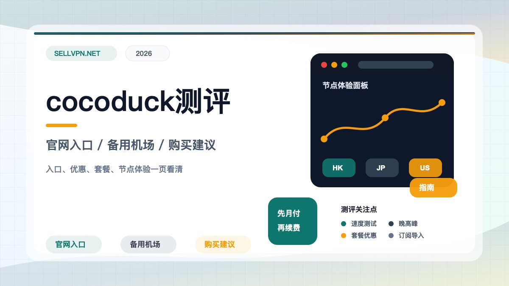

机场测试于 **2026 年 8 月 3 日**查看了登录后的 COCODUCK 商店。个人套餐当时报价 **¥17/月、100GB/月**，最低的年付方案为 **¥77/年、40GB/月**。首次只试一个月，个人套餐的预付款较低。[COCODUCK 商店记录](https://jichangceshi.com/posts/cocoduck)

> **联盟披露：** 本文部分注册入口包含推广参数。你通过这些链接注册或购买后，本站可能获得佣金。佣金关系不构成性能背书；价格、优惠与服务状态请以商家结算页为准。

**cocoduck机场** 是一款适合轻量使用、新手体验和备用订阅观察的机场服务。对于首次接触机场的用户来说，建议先关注官网入口、套餐透明度、节点稳定性、客户端教程和售后渠道，不要只看宣传词。

- 官网入口：[https://www.cocoduck.live](https://www.cocoduck.live/auth/register?code=cdb08a39e6)
- 优惠码：**暂无公开优惠码**
- 推荐定位：**新手体验 / 轻量备用 / 短周期测试**
- 购买建议：**先短周期体验，确认稳定后再续费**

本文会从 cocoduck机场官网入口、优惠信息、适合人群、节点体验、流媒体与 AI 工具访问、优缺点和购买建议等方面进行整理。

<!-- more -->

## 一、cocoduck机场是什么？

cocoduck机场是一个提供代理节点订阅的科学上网服务。用户购买套餐后，通常可以获得订阅链接，并导入 Clash Verge、Clash Mi、Shadowrocket、Stash、V2RayN、sing-box 等客户端使用。

它更适合下面几类用户：

- 想低门槛体验机场的新手
- 已经有主力机场，还想准备轻量备用的用户
- 日常主要访问 Google、Telegram、GitHub、ChatGPT 的用户
- 希望先短周期测试，再决定是否续费的用户

## 二、cocoduck机场官网入口与优惠信息

cocoduck机场官网入口：

[https://www.cocoduck.live](https://www.cocoduck.live/auth/register?code=cdb08a39e6)

注册链接中的 `code` 是邀请参数。机场测试 8 月整理的活动资料没有列出固定折扣，优惠金额需要在所选订单上核对。[COCODUCK 活动记录](https://jichangceshi.com/posts/airport-compare)

购买前建议查看：

- 套餐价格和流量
- 是否支持月付或体验套餐
- 是否限制设备数量
- 节点地区是否覆盖常用区域
- 是否支持常用客户端订阅
- 是否有公告、教程和客服渠道

## 三、cocoduck机场套餐与节点参考

8 月 3 日的商店记录中，四款常规套餐列有月付价格，另有一款只按年出售。表内价格是对应周期的标价。

| 套餐 | 付款金额 | 每月流量 |
| --- | ---: | ---: |
| 个人 | ¥17/月 | 100GB |
| 精英 | ¥31/月 | 200GB |
| 家庭 | ¥75/月 | 500GB |
| 团队 | ¥115/月 | 1,000GB |
| 迷你鸭77 | ¥77/年 | 40GB |

已有常规套餐的用户可以加购流量。50GB 为 ¥10，100GB 为 ¥20，500GB 为 ¥100，1,000GB 为 ¥200。比如个人套餐偶尔多用 50GB，当月合计 ¥27。若常常需要 200GB，精英月付标价 ¥31，比个人套餐每月再加购 100GB 少 ¥6。

当次查看的账户尚未购买套餐，会员中心没有展示独立节点状态页，无法据此核对节点数量、地区、协议或在线比例。[COCODUCK 套餐、加油包与会员中心记录](https://jichangceshi.com/posts/cocoduck)

## 四、cocoduck机场适合哪些人？

### 1. 适合新手短周期体验

cocoduck机场可以作为新手体验对象，但不建议首次直接购买长期套餐。先测试订阅导入、常用节点和晚高峰体验更稳妥。

### 2. 适合轻量备用

如果你的主力机场已经稳定，cocoduck可以作为备用订阅观察。备用机场的重点是入口可用、订阅能更新、常用节点能连接。

### 3. 适合普通日常使用

如果主要需求是网页浏览、Telegram、GitHub、AI 工具和轻度视频，可以把 cocoduck机场加入候选清单。

## 五、cocoduck机场节点体验怎么测？

建议按真实使用场景测试，而不是只看延迟：

| 测试维度 | 推荐测试方式 | 观察重点 |
| --- | --- | --- |
| 基础访问 | Google、GitHub、Wikipedia | 是否稳定打开 |
| 通讯工具 | Telegram 加载图片和频道 | 是否断连 |
| AI 工具 | ChatGPT、Claude、Gemini | 是否能登录和连续对话 |
| 视频播放 | YouTube 1080P / 4K | 缓冲是否明显 |
| 流媒体 | Netflix、Disney+、TikTok | 以节点实际解锁为准 |
| 晚高峰 | 20:00 到 24:00 | 是否频繁掉速 |

测试时建议覆盖白天和晚高峰两个时段。只在白天测试，无法判断晚上是否稳定。

## 六、cocoduck机场客户端配置建议

8 月 3 日的会员中心列有 Android、Android TV、Windows 和 macOS 自有客户端。iOS 和 OpenWrt 自有客户端当时仍标注开发中。iPhone 用户可从后台取用 Shadowrocket 订阅，电脑用户可按 Windows 或 macOS 的 Clash Verge 教程导入。会员页还列有 Quantumult、Stash、V2Ray 等订阅格式。[COCODUCK 客户端与订阅入口记录](https://jichangceshi.com/posts/cocoduck)

导入订阅后，可以先检查：

- 节点列表是否完整
- 手动更新订阅是否成功
- 规则模式是否可用
- Google 和 Telegram 是否稳定
- YouTube 是否能正常播放

## 七、cocoduck机场优缺点总结

### 优点

- 官网入口已整理，方便注册测试
- 入门月付门槛较低，适合先体验
- 个人套餐可按月购买，适合先验证连通性
- 适合新手短周期体验
- 可作为主力机场之外的轻量备用
- 适合网页、AI 工具和视频访问测试

### 不足

- 当前未收集到明确公开优惠码
- 套餐和节点状态需要以官网实时页面为准
- 需要自行测试本地网络体验
- 不建议首次直接长期购买

## 八、cocoduck机场购买建议

建议按以下顺序判断是否值得继续使用：

1. 先确认官网能正常访问
2. 查看套餐流量是否符合需求
3. 购买短周期套餐
4. 导入订阅并测试常用节点
5. 晚高峰重复测试
6. 观察客服公告和订阅更新情况

如果只是备用机场，重点看关键时刻能否连上；如果打算当主力机场，则要连续观察几天晚高峰表现。

## 九、cocoduck机场常见问题

### cocoduck机场有优惠码吗？

目前收集到的信息里没有明确公开优惠码，购买时以官网活动和结算页为准。

### cocoduck机场适合新手吗？

适合短周期体验。新手需要先了解订阅导入和客户端使用方式。

### cocoduck机场可以当备用机场吗？

可以纳入备用机场清单。是否长期保留，需要看你本地网络下的节点稳定性。

## 推荐阅读

- [2026年7月机场推荐排行榜](/posts/vpn-airport-ranking-2026/)
- [2026年7月最新机场优惠码汇总](/posts/airport-coupon-table/)
- [2026机场官网入口汇总](/posts/airport-official-links-2026/)
- [Clash Mi 使用教程](/blog/clashmi/)

## 总结

cocoduck机场适合新手体验和轻量备用。由于目前没有明确公开优惠码，购买时建议更关注套餐规则、节点稳定性和教程完整度，先短周期测试再决定是否长期续费。
