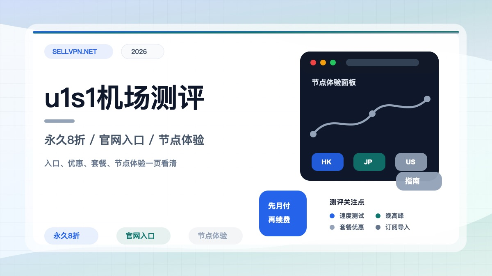

U1S1 的入门月付是 **¥20、120GB/月**，年付轻量档是 **¥96/年、60GB/月**。年付折合每月 ¥8，每月额度只有入门月付的一半。下列套餐取自机场测试在 **2026 年 8 月 3 日**查看的 U1S1 后台，均为商品标价。[U1S1 套餐与节点记录](https://jichangceshi.com/posts/u1s1)

<!-- more -->

## U1S1 机场套餐价格

| 面板套餐名 | 付款金额 | 流量 |
| --- | ---: | ---: |
| 普通人真够了包 | ¥20/月 | 120GB/月 |
| 你以为用不到包 | ¥40/月 | 300GB/月 |
| 瘾大就拉满包 | ¥100/月 | 700GB/月 |
| 我全都要包 | ¥180/月 | 1500GB/月 |
| 就是好用包 | ¥96/年 | 60GB/月 |
| 定制包 | ¥600/月 | 按需商定 |

如果每月用量在 70GB 左右，年付档即使摊到每月更便宜，也无法用当月额度覆盖。企业定制包的商品字段显示 0GB，方案说明写按需定制。需要固定带宽、流量或独立出口时，应在下单前取得与自己订单对应的报价。较早的资料曾列出 ¥580 的 1000GB 一次性包，8 月 3 日记录的六档商品中未见此项。[U1S1 商品详情记录](https://jichangceshi.com/posts/u1s1)

## U1S1 节点状态和客户端

8 月 3 日节点页显示 **69 个节点，68 个在线、1 个离线**，节点协议标为 VLESS，倍率为 1 倍。商品说明则提到 Shadowsocks、BGP 三网优化和 IEPL 出口。若沿用既有客户端，实际应以导入后显示的协议和节点为准。状态页没有记录晚高峰丢包、延迟与下载速度。[U1S1 节点与协议记录](https://jichangceshi.com/posts/u1s1)

当时后台提供 Android、iOS、macOS、Windows 客户端入口，知识库还列出 Linux 和软路由教程。商家宣称支持流媒体和 AI 服务，具体地区是否能播放目标片库或连续使用目标服务，仍需在自己的设备上验证。[机场测速方法](/posts/airport-speed-test-method-2026/) · [Clash Mi 使用教程](/blog/clashmi/)

## 优惠码和注册入口

8 月 4 日的推广资料将优惠码 `U1S1` 标为「永久 8 折」。后续订单能否继续打折、年付或定制档是否参加，需要分别核对所选商品的结算金额。[活动资料与适用范围说明](https://jichangceshi.com/posts/airport-compare)

> **联盟披露**　通过下方推广入口注册或购买，Sell VPN 可能获得佣金。[联盟披露](/affiliate-disclosure/)

[打开 U1S1 注册入口](https://sellvpn.vipaff.cc/#/?code=efD0Kxqq) · [2026机场推荐排行榜](/posts/vpn-airport-ranking-2026/) · [优惠码汇总](/posts/airport-coupon-table/) · [机场官网入口汇总](/posts/airport-official-links-2026/)
