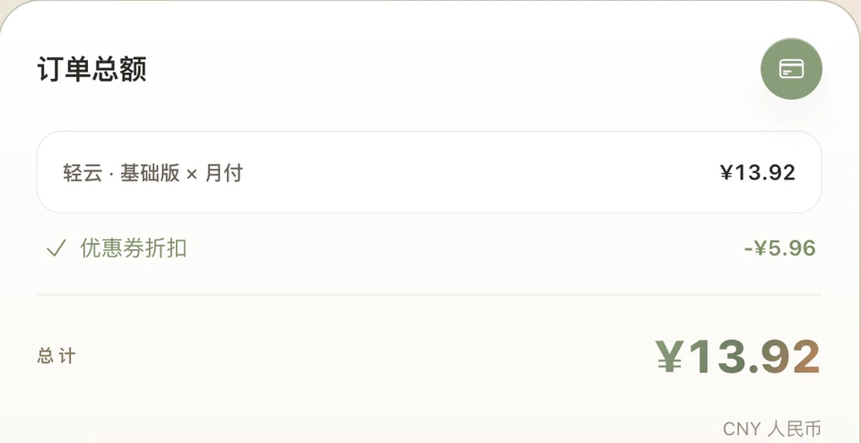

云界线入门月付是**轻云基础版**，每月 **130GB**，原价 **¥19.88**。新客用 `yjx888` 验券后，结算页显示 **¥13.92**。预算更低时可以看 ¥96 的年付小包，每 30 天刷新 60GB，前提是接受一次付清和较小的月度额度。

<!-- more -->

本文根据机场测试在 **2026 年 11 月 4 日至 5 日**的后台和结算核对底稿重写。套餐价格取自购买页，轻云折扣另有结算记录。测速数据取自该底稿记录的用户截图。

## 云界线套餐价格

| 常规套餐 | 每月流量 | 月付原价 | 季付原价 | 半年付原价 | 年付原价 |
| --- | ---: | ---: | ---: | ---: | ---: |
| 轻云基础版 | 130GB | ¥19.88 | ¥57.88 | ¥108.88 | ¥188.88 |
| 凌云进阶版 | 180GB | ¥24.88 | ¥72 | ¥135 | ¥239 |
| 御云高级版 | 350GB | ¥45.88 | ¥132.88 | ¥248.88 | ¥438.88 |
| 青云尊享版 | 600GB | ¥68.88 | ¥198.88 | ¥368.88 | ¥648.88 |

常规套餐的周期价格是一次应付的人民币总额，各付款周期的每月流量相同。轻云的商店资料另列 ¥10 流量重置包，是否适合应急要看当时的重置规则和剩余天数。

| 其他套餐 | 价格 | 额度及使用期限 |
| --- | ---: | --- |
| 云界年付小包 | ¥96 | 每 30 天刷新 60GB，购买页标为售完即止 |
| 闲云随心包 | ¥99 | 总共 80GB，套餐标为不限时 |
| 悠云长享包 | ¥199 | 总共 200GB，套餐标为不限时 |

用量每月不超过 130GB 时，轻云月付的首笔成本最低。升到凌云月付，每月多 50GB，原价多 ¥5。两款一次性包按实际使用量扣减，适合每隔一段时间才用的读者。经常用到每月几十 GB 时，可用轻云月付和年付小包的累计花费比较。

## yjx888 优惠码与云界线注册入口

<a href="https://wudaogang0.yunjiexianaff.com/#/?code=C5fSiHQU" rel="sponsored nofollow">打开云界线推广注册入口</a>。通过该链接购买，本站可能获得佣金。[联盟披露](/affiliate-disclosure/)

按 11 月 3 日的后台活动公告，新用户在结算页输入 `yjx888` 后点击兑换，首单 7 折，每位新用户限用一次。公告列出月付、季付、半年付和年付，实际适用套餐取决于结算结果。

- **轻云月付**验券后应付 **¥13.92**，轻云年付验券后应付 **¥132.22**。
- **凌云、御云和青云月付**的套餐卡分别列出 **¥17.42、¥32.12、¥48.22** 的首单价格。
- **云界年付小包**的结算页提示优惠码不可用，记录价格为 **¥96**。两款不限时包按原价比较。

## 云界线节点分布和联通测速

后台记录 **60 条 VLESS 节点**，香港 20 条，台湾、日本、新加坡和美国各 10 条，面板均显示 1× 倍率。以下是机场测试底稿收录的中国大陆联通样本。Clash Party v1.19.32 截图没有标出具体测试时间。MiaoKo 测试记录于 **2026 年 11 月 4 日 16:16:53**，截图标注 CST，使用 32 线程。表中下载读数保留截图单位。

| 地区 | 两图分别有有效读数 | Clash Party 延迟 | MiaoKo 平均下载读数范围 |
| --- | ---: | ---: | ---: |
| 香港 | 20/20 | 46–57 ms | 9.96–25.48 MB |
| 台湾 | 9/10 | 56–70 ms | 20.57–23.53 MB |
| 日本 | 10/10 | 85–99 ms | 644.80 KB–25.22 MB |
| 新加坡 | 9/10 | 69–89 ms | 21.16–25.37 MB |
| 美国 | 10/10 | 187–199 ms | 15.17–21.80 MB |

本轮香港延迟最短，日本同一地区的不同条目下载差距较大。台湾花莲和新加坡克拉码头在延迟图中超时，在下载图中显示 0.00 B。若经常用特定地区，可以在自家网络挑两条同地区节点，分别记录日间和晚高峰的结果。源资料未提供直连基线或连续多天的可用性记录。[机场测速方法](/posts/airport-speed-test-method-2026/)

## 常见问题

### 云界线 ¥96 年付是每月 60GB 吗？

购买页标明从购买日起，每 30 天刷新 60GB。¥96 是首次付款的全年总价，约合 ¥8/月。本次该套餐验券未通过。

### 云界线支持哪些设备？

入门套餐卡标注不限设备。多端导入前，确认客户端支持 VLESS 和后台提供的订阅格式，再检查同一账号的流量扣除。[Clash Verge 配置教程](/blog/clash-verge/) · [Shadowrocket 导入教程](/blog/shadowrocket/)

[查看机场官网入口汇总](/posts/airport-official-links-2026/) · [查看机场优惠码汇总](/posts/airport-coupon-table/)
