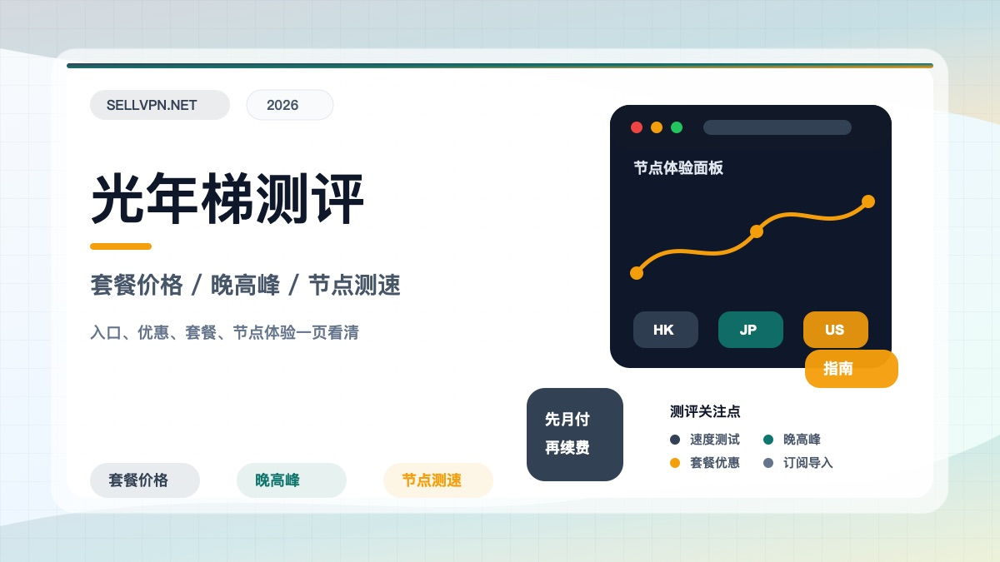

光年梯入门版标价 **¥18/月，每月 110GB**。机场测试于 **2026 年 11 月 12 日**在新客账户输入 `sell75`，结算页显示月付 **¥13.50**。购买前要先看设备：常规套餐使用官方客户端，核对所用的晋级版账户没有可复制给 Clash 或 Shadowrocket 的订阅地址。[光年梯商店、验券与客户端记录](https://jichangceshi.com/posts/guangnianti)

> **联盟披露**　下方入口含邀请码。经此购买，Sell VPN 可能获得佣金。[联盟披露说明](/affiliate-disclosure/)

[访问光年梯注册入口](https://sellvpn.gntvipaff.cc/#/?code=btzIT9Fo)

<!-- more -->

## 50GB 年付与 110GB 月付怎么选

| 套餐 | 每月额度 | 最短付款周期及标价 | 11 月 12 日首单验券结果 |
| --- | ---: | --- | --- |
| 限时年付 | 50GB | ¥89/年 | 该档未通过 |
| 入门版 | 110GB | ¥18/月 | 月付 ¥13.50，年付 ¥160 降至 ¥120 |
| 晋级版 | 220GB | ¥34/月 | 待核实 |
| 专业版 | 450GB | ¥68/月 | 待核实 |
| 至尊版 | 900GB | ¥130/月 | 待核实 |
| 独享私人专线 | 500GB | ¥680/月 | 待核实 |

每月需要约 80GB 时，¥89 的年付档即使全年总用量不高，也会遇到每 30 天 50GB 的上限。110GB 入门版当时的首单年付折合 ¥10/月，首笔需付 ¥120。按月购买的读者可以先用 ¥13.50 的首单报价核算试用成本。此次记录止于验券，续费价及活动到期日尚待确认。[光年梯各周期价格与验券记录](https://jichangceshi.com/posts/guangnianti)

## 已有客户端能否继续用

常规套餐可从后台下载 Android、iOS、macOS、Windows 客户端，Linux 安装包在知识库。仪表盘的二维码用于下载客户端。单独销售的 ¥680 私人专线才在商品说明中列出专属配置、订阅和路由器支持。需要路由器或第三方客户端时，应先让客服确认具体型号和配置格式。常规套餐页面还写明不提供退款。[机场测试的客户端入口与知识库记录](https://jichangceshi.com/posts/guangnianti)

## 节点在线数与实际体验

11 月 12 日，晋级版账户列出 62 条 VLESS 节点记录，均标为 1 倍。香港、日本、新加坡、美国与台湾共 55 条显示在线，马来西亚、土耳其及德国共 7 条当时离线。IPLC 是商品页对线路的标注。依赖德国出口的用户，尤其需要确认目前能否连接。[光年梯节点状态记录](https://jichangceshi.com/posts/guangnianti)

Siilas 在 MacBook 上通过 Wi-Fi 使用光年梯客户端测速。10 月 8 日 20:43（北京时间）的香港样本下载为 121.46 Mbps，测试者当时未能访问 ChatGPT。11 月 4 日 09:01 的日本样本下载为 526.40 Mbps，测试者可以访问 ChatGPT。两次采样的出口、时段和测速服务器不同，测试者也未记录本地运营商。若主要用途是视频或 AI 服务，除测速外，还要在常用时段实际播放视频或完成一次对话。[Siilas 测速原始记录](https://siilas.com/airport/guangnianti/) · [Sell VPN 机场测速方法](/posts/airport-speed-test-method-2026/)

[查看其他机场套餐对比](/posts/vpn-airport-ranking-2026/)
