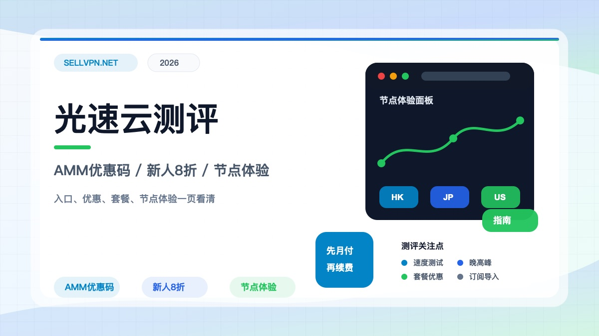

机场测试于 **2026 年 8 月 2 日**查看了光速云商店和节点页。下文引用当时的标价与节点状态，优惠码另据 8 月 4 日的活动资料。[光速云后台记录](https://jichangceshi.com/posts/guangsuyun)

> **联盟披露：** 本文部分注册入口包含推广参数。你通过这些链接注册或购买后，本站可能获得佣金。佣金关系不构成性能背书；价格、优惠与服务状态请以商家结算页为准。

**光速云机场** 是一款适合日常科学上网和备用订阅对比的机场服务。8 月的极速版标价 ¥17/月，每期 110GB，适合按月观察自己的用量和连接情况。

- 官网入口：[https://wudaogang.gsyaff.com](https://wudaogang.gsyaff.com/#/?code=3t2CE1r6)
- 优惠码：`AMM`
- 活动资料标注新人首次 8 折，订单金额待核对。
- 公开资料参考：入门月付约 **¥17/月110GB**，另有轻量年付和一次性不限时流量口径
- 推荐定位：**日常使用 / 新人体验 / 备用机场**
- 购买建议：**先确认优惠码生效，再短周期测试**

本文会围绕光速云机场的官网入口、优惠码、适合人群、节点体验、流媒体与 AI 工具访问、优缺点和购买建议进行整理。

<!-- more -->

## 一、光速云机场是什么？

光速云机场是一个提供代理节点订阅的科学上网服务。购买套餐后，用户通常可以获得订阅链接，并导入 Clash Verge、Clash Mi、Shadowrocket、Stash、V2RayN、sing-box 等客户端使用。

它适合用于：

- 访问 Google、GitHub、Telegram 等常用网站
- 使用 ChatGPT、Claude、Gemini 等 AI 工具
- 观看 YouTube、Netflix、Disney+ 等流媒体
- 给主力机场准备备用线路
- 对比不同机场在本地宽带下的速度表现

## 二、光速云机场官网入口与优惠码

光速云机场官网入口：

[https://wudaogang.gsyaff.com](https://wudaogang.gsyaff.com/#/?code=3t2CE1r6)

8 月 4 日的活动资料把 `AMM` 列为新人首单 8 折。资料未附验券账单，也未注明不限时包、特殊商品能否参加。购买时请查看所选周期的实际减免。[光速云优惠活动记录](https://jichangceshi.com/posts/airport-compare)

建议购买流程：

1. 打开官网入口并注册账号
2. 查看套餐流量、价格和节点说明
3. 选择短周期套餐
4. 在结算页输入 `AMM`
5. 确认折扣后付款
6. 导入订阅并测试常用节点

## 三、光速云机场套餐价格参考

机场测试 8 月 2 日记录了七款商品。四档常规月付在商品页标注每 30 天刷新流量，年付轻量版按月提供 59GB。

| 套餐 | 标价 | 流量 |
| --- | ---: | --- |
| 极速版 | ¥17/月 | 110GB/月 |
| 流光版 | ¥34/月 | 220GB/月 |
| 量子版 | ¥68/月 | 450GB/月 |
| 无界版 | ¥130/月 | 900GB/月 |
| 轻量版 | ¥99/年 | 59GB/月 |
| 不限时包 | ¥680/次 | 共 1,000GB |
| 定制套餐 | ¥680/月起 | 500GB/月，按地区和配置报价 |

两款 ¥680 商品的用途不同。不限时包的 1,000GB 没有自动重置，商品列出的手动重置费为 ¥612。定制档则按月计费，独立带宽、地区与最终价格需另行商定。轻量年付等特殊商品在当时的商店标有不支持退款。[光速云商店记录](https://jichangceshi.com/posts/guangsuyun)

当日节点页显示 **70 条在线、0 条离线**，列表标注 VLESS 协议、1× 倍率，地区包括香港、日本、新加坡、美国等。在线统计反映服务商后台在该时点的检测结果。该记录没有给出用户侧的丢包率或晚高峰下载速度。[光速云节点记录](https://jichangceshi.com/posts/guangsuyun)

## 四、光速云机场适合哪些人？

### 1. 适合新人试用

光速云的极速版支持月付。若想使用新人折扣，可先查看订单是否接受活动码。建议不要只看折扣，还要看套餐是否适合自己的使用量。

### 2. 适合日常科学上网

如果你的需求主要是 Google、GitHub、Telegram、ChatGPT 和 YouTube，光速云可以作为候选机场测试。核心要看晚高峰是否稳定。

### 3. 适合作为备用机场

如果你已经有主力机场，可以把光速云放进备用清单。备用机场的价值在于主力波动时能快速切换。

## 五、光速云机场节点体验怎么测？

建议从真实使用场景入手：

| 测试项目 | 测试方式 | 判断标准 |
| --- | --- | --- |
| 基础网页 | Google、GitHub、Wikipedia | 页面打开稳定 |
| 通讯工具 | Telegram 加载频道和媒体 | 消息同步正常 |
| AI 工具 | ChatGPT 连续对话 | 不频繁受限或断开 |
| 视频播放 | YouTube 1080P / 4K | 缓冲少、拖动顺滑 |
| 流媒体 | Netflix、Disney+ | 以节点实际解锁为准 |
| 晚高峰 | 20:00 到 24:00 | 不明显拥堵 |

测试时尽量固定设备、宽带和客户端，避免把客户端配置问题误判成机场线路问题。

## 六、光速云机场客户端配置建议

同次后台记录中，Android、iOS、macOS 和 Windows 均有客户端入口。下载页标注的最低系统版本分别为 Android 5.0、iOS 12、macOS 10.15 和 Windows 10。知识库另有 Linux 分类，适用的发行版和安装方式需要登录查看。[光速云客户端记录](https://jichangceshi.com/posts/guangsuyun)

新手建议优先使用规则模式，避免国内网站也走代理导致速度变慢。导入订阅后，先手动更新订阅，再选择延迟较低且实际访问稳定的节点。

## 七、光速云机场优缺点总结

### 优点

- 官网入口清晰，注册流程直接
- 活动资料列有新人优惠码可在结算时核对
- 适合短周期测试和备用订阅
- 可用于日常网页、AI 工具和视频访问
- 适合与其他机场做横向对比

### 不足

- 优惠码通常限制新人首次使用
- 套餐和节点状态需要以官网实时页面为准
- 首次购买前需要自己测试本地网络体验
- 流媒体解锁能力需要按节点实际确认

## 八、光速云机场购买建议

购买前建议确认：

- 优惠码 `AMM` 是否生效
- 套餐流量是否够用
- 是否限制设备数量
- 节点是否覆盖常用地区
- 订阅链接是否方便导入客户端
- 是否有公告和客服渠道

如果测试目标是日常使用，建议至少覆盖白天和晚高峰两个时段。如果晚高峰表现稳定，可以考虑继续使用。

## 九、光速云机场常见问题

### 光速云机场有优惠码吗？

8 月的活动资料列有新人首单 8 折码 `AMM`。有效期、参与商品和实际金额以所选订单为准。

### 光速云机场适合新手吗？

适合短周期体验。新手需要先了解订阅导入和客户端使用方式，建议配合 Clash 或 Shadowrocket 教程使用。

### 光速云机场能看流媒体吗？

需要按节点实际测试。流媒体解锁会随平台风控变化，建议购买后测试自己常看的服务。

## 推荐阅读

- [2026年7月机场推荐排行榜](/posts/vpn-airport-ranking-2026/)
- [2026年7月最新机场优惠码汇总](/posts/airport-coupon-table/)
- [2026机场官网入口汇总](/posts/airport-official-links-2026/)
- [Clash Mi 使用教程](/blog/clashmi/)

## 总结

光速云机场适合想用新人优惠短周期测试的用户，也适合作为主力机场之外的备用选择。购买前重点确认优惠码、套餐规则和节点地区，使用后重点测试晚高峰稳定性和常用服务访问效果。
