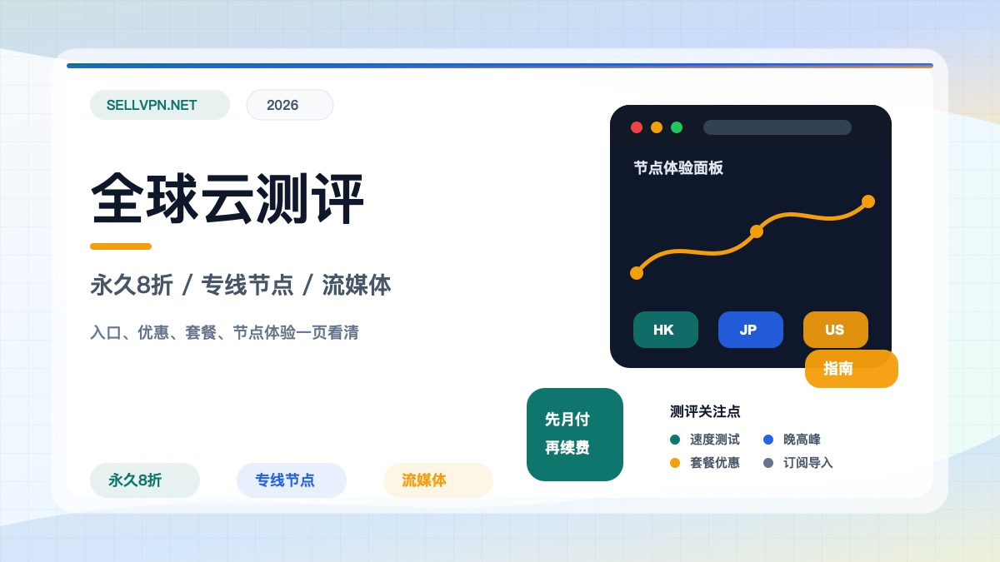

全球云的入门月付标价 **¥20，每月 120GB**。轻量版标价 ¥99/年，每月 59GB。如果某个月预计用 80GB，年付档虽然折合每月 ¥8.25，那个月的额度仍然不够。以下标价和节点状态取自机场测试在 **2026 年 8 月 2 日**查看的全球云后台。[全球云套餐与节点记录](https://jichangceshi.com/posts/quanqiuyun)

<!-- more -->

## 全球云机场套餐价格与流量

| 套餐 | 商店标价 | 可用流量 |
| --- | ---: | ---: |
| 轻量版 | ¥99/年 | 每月 59GB |
| 入门方案 | ¥20/月 | 每月 120GB |
| 进阶方案 | ¥40/月 | 每月 300GB |
| 高端方案 | ¥100/月 | 每月 700GB |
| 商业方案 | ¥180/月 | 商店标注每月 1.5TB |
| 独享私人专线节点 | ¥680/月 | 每月 500GB |

商业方案有一处需要确认。当时商品页写每月 1.5TB，第三方查看的同名订阅账户却显示总流量 120GB。原因未获证实。如果按 1.5TB 做预算，应在付款前请客服确认具体订单开通后的额度。独享私人专线另有独立公网 IP 和独立带宽的商品说明，下单时还需核对带宽数值和交付时间。[全球云后台与商业方案额度对照](https://jichangceshi.com/posts/quanqiuyun)

另有三档一次性包，分别是 **100GB/¥100、400GB/¥360、800GB/¥700**。商品都标为不限时，流量在符合商品规则的使用期内合计扣除。以 100GB 包为例，¥100 等于五次入门月付的标价。如果只在一年中的某几周用订阅，选择时可对比全年总用量、需要开通的月份数和首次付款金额。

## 全球云机场节点与线路

8 月 2 日的节点页列出 **71 个节点，其中 70 个在线、1 个离线**。可见地区包括香港、台湾、日本、新加坡、美国、马来西亚和德国。商品文案提到 BGP 优化和 Shadowsocks，节点列表当时显示 VLESS、1 倍流量。沿用现有客户端时，可以查看自己订阅中实际下发的协议。该记录没有本地测速或逐节点的流媒体解锁结果。[全球云节点页与协议记录](https://jichangceshi.com/posts/quanqiuyun)

后台提供 Android、iOS、macOS 和 Windows 的客户端下载入口。帮助中心另有 Linux 分类。需要长期使用某地区的线路时，可在相同网络下分别测白天和晚高峰的延迟、丢包及连接成功率。[机场测速方法](/posts/airport-speed-test-method-2026/)

## qq88 优惠与注册入口

8 月 4 日整理的活动资料将 `qq88` 标为「永久 8 折」。该记录未给出具体订单的验券金额，特殊套餐资格及续费折扣仍需在结算页确认。[机场测试的优惠资料说明](https://jichangceshi.com/posts/airport-compare)

> **联盟披露**　通过下方推广入口注册或购买，Sell VPN 可能获得佣金。[联盟披露](/affiliate-disclosure/)

[打开全球云注册入口](https://sellvpn.gcvipaff.cc/#/?code=eZQbQpGe) · [2026机场推荐排行榜](/posts/vpn-airport-ranking-2026/)
