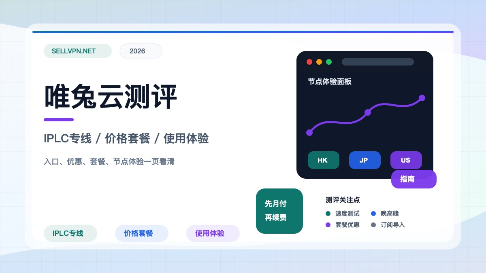
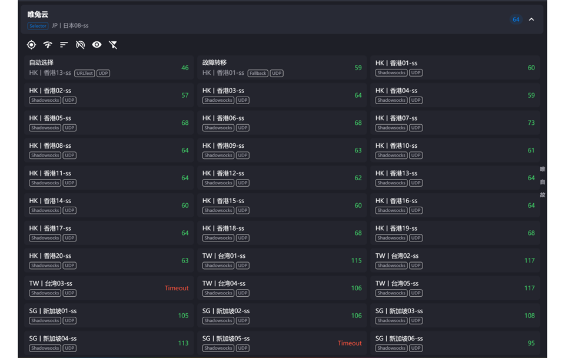
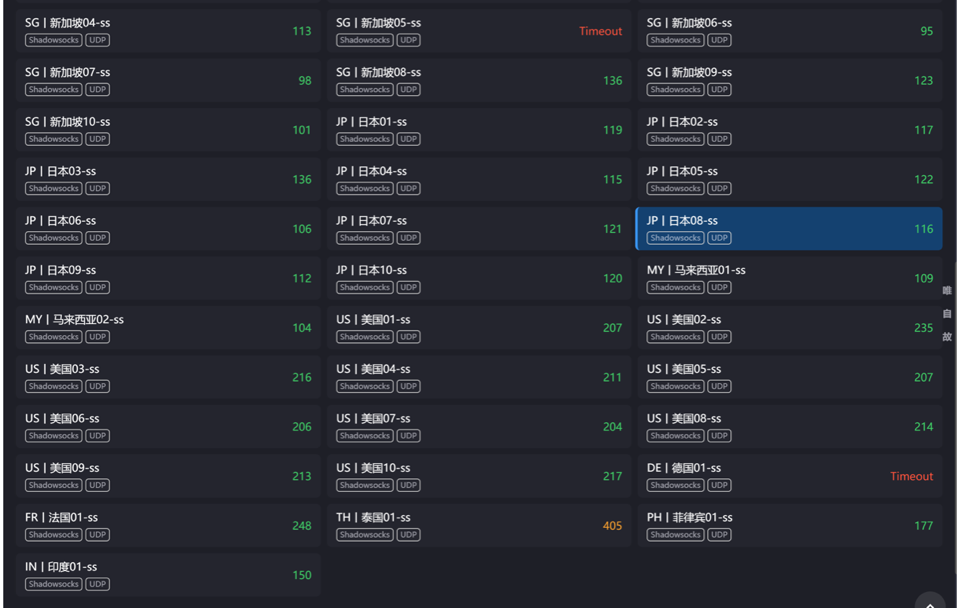

唯兔云（OnlyRabbit）的 **¥14.90/月、100GB** 套餐只在节假日限时开放。没有这档活动时，普通版标价 **¥19.90/月、150GB**。两档相差 ¥5 和 50GB。标价来自机场测试于 **2026 年 8 月 2 日**查看的唯兔云后台，活动是否开放需在购买当天确认。[唯兔云套餐与节点记录](https://jichangceshi.com/posts/weituyun)

<!-- more -->

## 唯兔云套餐价格

| 套餐 | 每月额度 | 商店标价 |
| --- | ---: | ---: |
| 节假日限时档 | 100GB | ¥14.90/月起 |
| 普通版 | 150GB | ¥19.90/月 |
| 进阶版 | 200GB | ¥29.90/月 |
| 专业版 | 500GB | ¥59.90/月 |
| 至尊版 | 1000GB | ¥119.90/月 |
| 年付限量款 | 45GB | ¥79.90/年 |
| 年付加强专线 | 75GB | ¥120/年 |

每月需要约 60GB 时，45GB 年付档的月额度不足。75GB 年付档折合 ¥10/月，首笔付款为 ¥120。如果只需要用一个月，可以先比较月付档的当期支出。

按总量购买还有三档，分别为 **100GB/¥100、200GB/¥160、500GB/¥340**，商品页均标为不限时。比如为一次出差买 100GB 包，全年余下时间很少使用，按商品说明可以保留剩余流量。购买前请确认账户到期和余额处理规则。[唯兔云月付、年付及一次性包记录](https://jichangceshi.com/posts/weituyun)

## 节点状态与历史测速截图

8 月 2 日的节点页列出 **67 个节点，63 个在线、4 个离线**。节点标注 VLESS 协议和 1 倍流量，可见香港、台湾、日本、新加坡和美国等地区。IPLC、流媒体和 AI 平台支持属于商品说明，当次后台记录没有逐个节点的播放或登录测试。[唯兔云节点状态记录](https://jichangceshi.com/posts/weituyun)

本站 3 月资料将这组截图的环境列为 100M 宽带和 Clash 客户端，缺少完整的采样日期、运营商和重复测量结果。准备长期使用某一地区时，可在自己的网络上分别记录白天、晚间丢包和视频缓冲，再选择线路。[机场测速方法](/posts/airport-speed-test-method-2026/)

## 客户端与新人优惠

8 月的后台有 Windows、macOS、Android 和 iOS 下载入口。帮助中心还列出 Linux、软路由与通用客户端下载分类。商品页写可以多设备使用，同时在线的设备数需要按具体套餐确认。

8 月 4 日的活动资料将 `rabbit` 列为新客首次 9 折。节假日价能否再用券、续费金额如何计算，这份资料没有给出结算结果。[机场测试的优惠资料说明](https://jichangceshi.com/posts/airport-compare)

> **联盟披露**　通过下方推广入口注册或购买，Sell VPN 可能获得佣金。[联盟披露](/affiliate-disclosure/)

[打开唯兔云注册入口](https://sellvpn.v2cvipaff.cc/#/?code=hr6gESut) · [2026机场推荐排行榜](/posts/vpn-airport-ranking-2026/)
