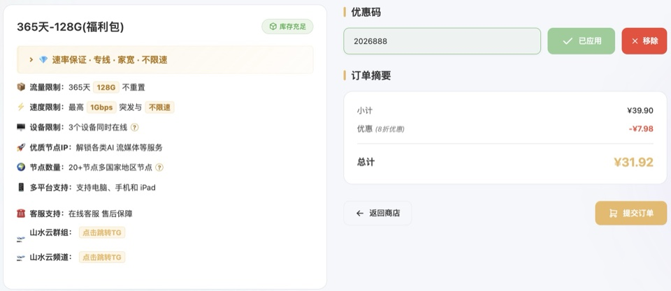

山水云的「琴」套餐每月有 **100GB**，原价 **¥12**，用优惠码 `2026888` 后，结算显示 **¥9.60**。偶尔使用可以比较 **¥31.92 的 128GB 福利包**，整包额度可在 365 天内消耗。每月都有固定用量时，先比较月度额度、首次付款和到期规则。

<!-- more -->

套餐、验券和节点资料来自机场测试于 **2026 年 11 月 12 日**核对的商店及后台。报价以该次结算页面为依据。性能数据来自下文注明的第三方探针。[机场测试的山水云资料](https://jichangceshi.com/posts/shanshuiyun)

## 山水云套餐怎么选

| 套餐 | 流量 | 所列周期 | 原价 | 用券后应付 |
| --- | ---: | --- | ---: | ---: |
| 琴 | 每月 100GB | 月付 | ¥12 | ¥9.60 |
| 棋 | 每月 200GB | 月付 | ¥20 | ¥16 |
| 书 | 每月 500GB | 月付 | ¥39 | ¥31.20 |
| 64G 轻量 | 每月 64GB | 年付 | ¥77 | ¥61.60 |
| 128G 轻量 | 每月 128GB | 季付 / 年付 | ¥33 / ¥128 | ¥26.40 / ¥102.40 |
| 128G 福利包 | 合计 128GB | 365 天 | ¥39.90 | ¥31.92 |
| 256G 福利包 | 合计 256GB | 365 天 | ¥59.90 | ¥47.92 |
| 梅兰 | 合计 100GB | 不限时 | ¥99 | ¥79.20 |

琴、棋和书还有季付至两年付选项。原价按月费等比例增加，可以先付一个月观察线路。128G 轻量季付用券后折合 **¥8.80/月**，一次支付 **¥26.40**。64G 轻量年付折合约 **¥5.13/月**，需要一次付清 **¥61.60**。前五档按商品说明在次月购买日重置流量。

如果预算是一次付三十元左右，**128G 轻量季付**每月重置 128GB，**128G 福利包**则在有效期内共用 128GB。机场测试的既有账号把福利包标为「永久」，商店和结算页均写 365 天，新购时按 365 天估算。梅兰商品说明明确写不限时，用完为止。商品卡还标明可同时使用 3 台设备，具体并发计数规则待确认。

## 2026888 优惠码怎么用

浏览器打开的普通注册页未携带邀请码，表单的邀请码栏可留空。套餐优惠码填写在结算页。

从[山水云注册入口](https://47.86.34.254:5210/#/register)登录后选定套餐及付款周期，在确认订单页输入 `2026888`，点击验证，再核对优惠金额与应付总额。后台公告将活动标为永久 8 折，资料已覆盖表中的九种报价。公告未列截止日，续费和重复用券请按自己的结算页核对。

## 山水云节点覆盖与第三方测速

128G 福利包账号的节点列表显示香港 8 条、台湾 7 条、日本 7 条、新加坡 7 条、美国 4 条，共 **33 条地区记录**。其中 5 条标为备用，地区记录均显示 **VLESS、1×**。香港有两条名称几乎相同的记录，以上按后台条目计数，实际出口数量待确认。

| 第三方数据 | 采样日期 | 延迟 | 下载速率 | 可用率 |
| --- | --- | ---: | ---: | --- |
| [JichangView](https://jichangview.com/shanshuiyun) | 2026-11-19 | 104.50 ms | 358.40 Mbps | 当日 98.72% |
| [GateRank](https://gate-rank.com/airports/shanshuiyun) | 2026-11-20 | 中位数 276.07 ms | 172.32 Mbps | 近 30 天 100% |

截至 11 月 20 日，两站最近的一次公开记录分别列于上表。JichangView 随机抽取节点，当天还录得 0.60% 丢包。GateRank 公布的是自身采样的中位延迟和滚动 30 天可用率，其 11 月 20 日报告另列代理请求失败率 66.67%，并注明各测试地区差异仍在复核。两组延迟差异较大，适合用来决定是否值得做短期测试。首次使用时，固定常用地区和测试目标，在日间和晚高峰分别记录丢包、下载与重连情况。[机场测速方法](/posts/airport-speed-test-method-2026/)

## 山水云支持哪些客户端

后台文档给出了 Windows 的 Clash Verge、Android 的 Clash Meta 和 iOS 的 Shadowrocket 等配置入口。已有客户端时，先检查是否支持 VLESS 与对应订阅格式，再从后台导入。长时间视频或 AI 工具访问要用实际目标服务逐项核验。购买前可用后台工单确认退款和到期规则。[Clash Verge 配置教程](/blog/clash-verge/) · [Shadowrocket 导入教程](/blog/shadowrocket/)

## 常见问题

### 山水云有没有免费试用？

2026 年 11 月 12 日的商店资料未显示免费试用档。记录中首次付款最低的是券后 ¥9.60 的琴月付。

### 山水云的 128GB 福利包用完会重置吗？

商店写明 365 天内共用 128GB，期间没有固定重置日。需要每月有 128GB 的用户，可以查看 128G 轻量季付或年付。

### 山水云 1× 倍率怎么扣量？

按后台所列倍率，传输 10GB 对应约 10GB 套餐额度。实际计费可在客户端传输一段已知大小的数据后，查看后台流量明细。

[查看机场官网入口汇总](/posts/airport-official-links-2026/) · [对照各家机场优惠码](/posts/airport-coupon-table/)
