快狸月狸套餐每 30 天提供 **50GB**，月付标价 **¥15**。2026 年 11 月 14 日输入优惠码 **`sellvpn`** 后，月付结算页显示应付 **¥12**。森狸年付当时报价 **¥96**，需要一次付清，每 30 天提供 30GB。[查看三张验券截图](#coupon-evidence)

<!-- more -->

<a href="https://wudao01.kuailiaff.com/#/?code=ngH6LgR6" rel="sponsored nofollow noopener noreferrer" target="_blank">通过邀请链接打开快狸</a>

**联盟披露**：通过邀请链接注册或购买，SellVPN 可能获得佣金。

## 六档套餐价格对照

套餐标价取自 2026 年 11 月 14 日的套餐页和公开接口。下表用粗体标出有当日结算截图的三项报价，其余金额均按标价乘以 0.8 估算。重置流量按次计费。

| 套餐 | 每 30 天流量 | 最短付款周期 | 标价 → 八折金额 | 单次重置标价 → 八折金额 |
| --- | ---: | --- | ---: | ---: |
| 森狸年付小套餐 | 30GB | 年付 | ¥120 → **¥96** | ¥15 → ¥12 |
| 月狸月付小套餐 | 50GB | 月付 | ¥15 → **¥12** | ¥17 → ¥13.60 |
| 小狸基础版 | 100GB | 月付 | ¥22 → ¥17.60 | ¥20 → ¥16 |
| 灵狸标准版 | 250GB | 月付 | ¥35 → ¥28 | ¥30 → ¥24 |
| 夜狸强化版 | 500GB | 月付 | ¥95 → ¥76 | ¥90 → ¥72 |
| 天狸顶配版 | 1,000GB | 月付 | ¥180 → ¥144 | ¥175 → **¥140** |

套餐页标注**流量每 30 天自动刷新、全节点按 1× 扣量、同时在线设备数量不限**。付款周期决定一次要付多少钱，流量仍按每 30 天发放。付费重置是后台单独列出的商品。用量经常超出时，先比较升级和重置的费用，再核对重置生效时间和到期日。

### 森狸年付小套餐 · 30GB

<figure class="kuaili-evidence">
  <a href="/images/kuaili/plan-sen.webp">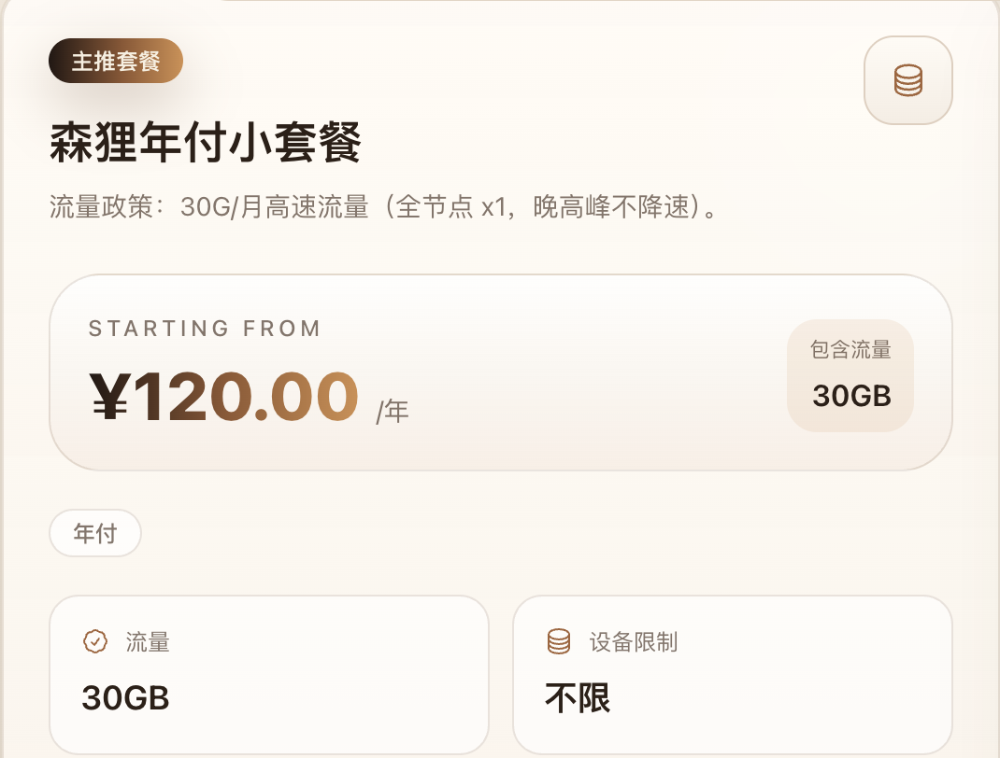</a>
  <figcaption>森狸后台套餐卡。¥120/年是起始标价，每 30 天提供 30GB。</figcaption>
</figure>

森狸适合每 30 天用量稳定在 30GB 以内的人，例如主要用于网页、邮件和备用连接。年付 ¥96 是一次结清的券后金额，月均 ¥8。常看高清视频、经常传大文件，或还在验证快狸能否满足自己的使用场景，可以先看月狸。

| 付款周期 | 标价 | 按八折估算总价 | 折合每月 |
| --- | ---: | ---: | ---: |
| 年付 | ¥120 | ¥96 | ¥8 |
| 两年付 | ¥235 | ¥188 | 约 ¥7.83 |
| 三年付 | ¥350 | ¥280 | 约 ¥7.78 |

流量重置标价 ¥15/次，按 8 折估算为 ¥12。若三个年度都能用券，三年付约比逐年支付省 ¥8，但需要一次付 ¥280。

### 月狸月付小套餐 · 50GB

<figure class="kuaili-evidence">
  <a href="/images/kuaili/plan-yue.webp">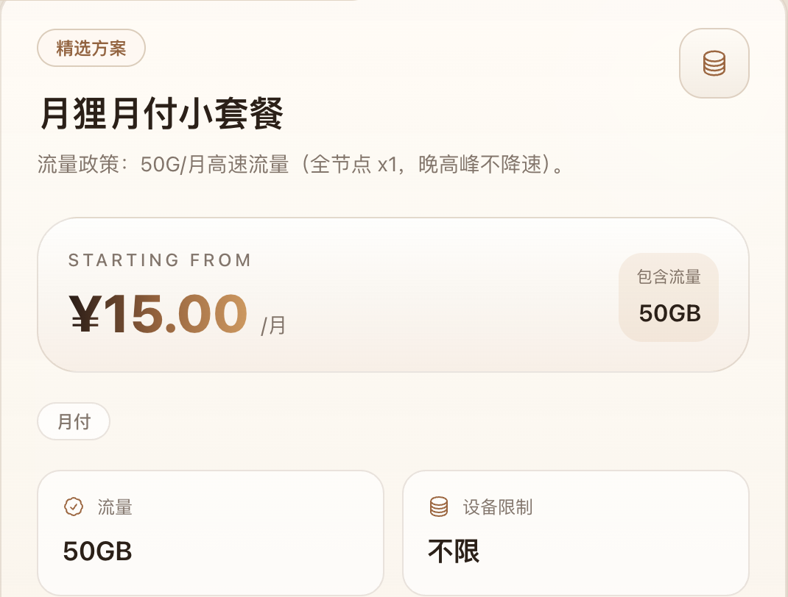</a>
  <figcaption>月狸后台套餐卡。卡片显示 ¥15/月和 50GB，付款周期只有月付。</figcaption>
</figure>

月狸只提供月付，原价 **¥15**，券后 **¥12**，每 30 天刷新 50GB。它的单次付款门槛最低，适合第一次测试快狸、用作备用，或者主要在手机上浏览网页、发消息和偶尔看视频。

流量重置标价 ¥17/次，按 8 折估算为 ¥13.60，比当月订阅报价多 ¥1.60。若小狸月付也能用券，多 ¥5.60 可换到 100GB。临时补量可先向客服确认重置与续订各自的生效时间。

### 小狸基础版 · 100GB

<figure class="kuaili-evidence">
  <a href="/images/kuaili/plan-xiao.webp">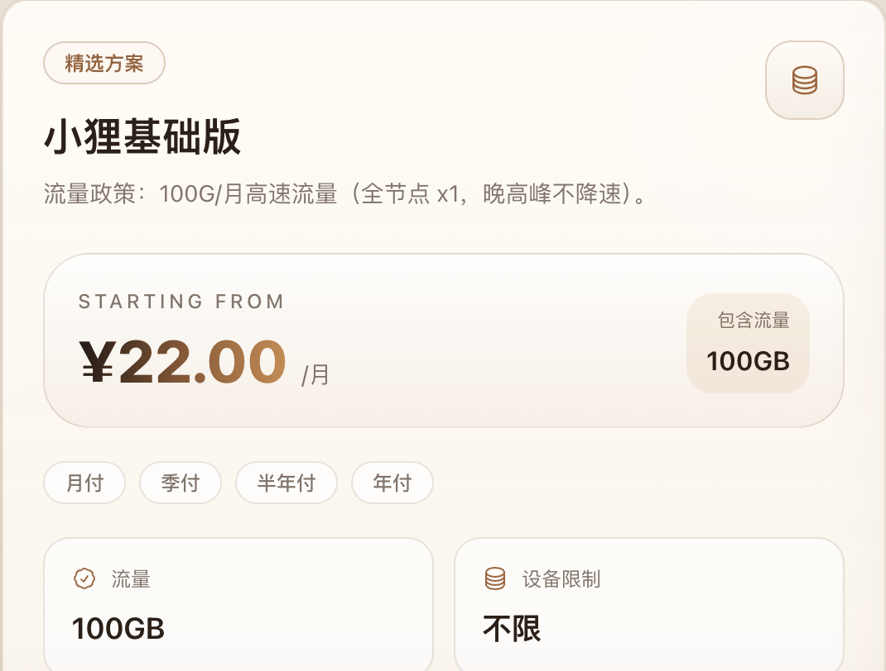</a>
  <figcaption>小狸后台套餐卡。起始标价 ¥22/月，每 30 天 100GB，其他付款周期的价格见下表。</figcaption>
</figure>

小狸适合每月用量超过 50GB，平时用手机和电脑浏览网页、使用 AI 工具、偶尔看视频的人。按 8 折估算，月付 ¥17.60。流量与月狸相比翻倍，月费增加 ¥5.60。

| 付款周期 | 标价 | 按八折估算总价 | 折合每月 |
| --- | ---: | ---: | ---: |
| 月付 | ¥22 | ¥17.60 | ¥17.60 |
| 季付 | ¥62 | ¥49.60 | 约 ¥16.53 |
| 半年付 | ¥125 | ¥100 | 约 ¥16.67 |
| 年付 | ¥255 | ¥204 | ¥17 |
| 两年付 | ¥514 | ¥411.20 | 约 ¥17.13 |
| 三年付 | ¥775 | ¥620 | 约 ¥17.22 |

流量重置标价 ¥20/次，按 8 折估算为 ¥16。若各次下单均能用券，四次季付共 ¥198.40，比年付少 ¥5.60。月付加一次重置合计 ¥33.60，已经超过灵狸月付的 ¥28。

### 灵狸标准版 · 250GB

<figure class="kuaili-evidence">
  <a href="/images/kuaili/plan-ling.webp">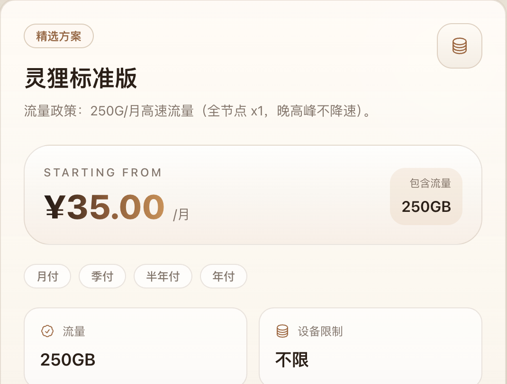</a>
  <figcaption>灵狸后台套餐卡。¥35/月对应 250GB，图片显示设备数量不限。</figcaption>
</figure>

灵狸适合经常在多台设备看视频、使用在线工具或传文件，每月需要 100GB 以上的人。按 8 折估算，月付 ¥28，用满标注的流量额度约 ¥0.112/GB，是五档月付中单 GB 报价最低的一档。

| 付款周期 | 标价 | 按八折估算总价 | 折合每月 |
| --- | ---: | ---: | ---: |
| 月付 | ¥35 | ¥28 | ¥28 |
| 季付 | ¥103 | ¥82.40 | 约 ¥27.47 |
| 半年付 | ¥208 | ¥166.40 | 约 ¥27.73 |
| 年付 | ¥415 | ¥332 | 约 ¥27.67 |
| 两年付 | ¥830 | ¥664 | 约 ¥27.67 |
| 三年付 | ¥1,250 | ¥1,000 | 约 ¥27.78 |

流量重置标价 ¥30/次，按 8 折估算为 ¥24。季付折合约 ¥27.47/月，比月付每月少约 ¥0.53，适合同时在意付款灵活性和月均成本的人对照。

### 夜狸强化版 · 500GB

<figure class="kuaili-evidence">
  <a href="/images/kuaili/plan-ye.webp">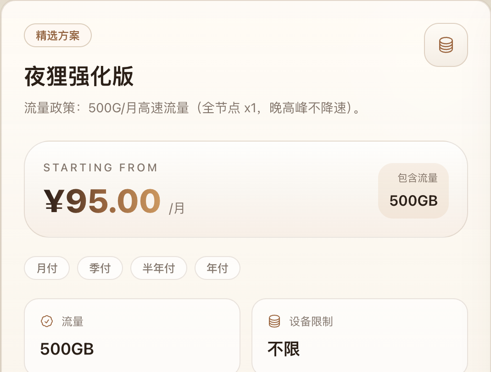</a>
  <figcaption>夜狸后台套餐卡。¥95/月是月付标价，每 30 天 500GB。</figcaption>
</figure>

夜狸适合每月经常超过 250GB，且有高清视频、长时间播放或较多大文件传输的用户。按 8 折估算，月付 ¥76，额度是灵狸的两倍，月费多 ¥48。套餐文案列出的线路和设备规则与其他档相同，这一档的主要变化是流量和价格。

| 付款周期 | 标价 | 按八折估算总价 | 折合每月 |
| --- | ---: | ---: | ---: |
| 月付 | ¥95 | ¥76 | ¥76 |
| 季付 | ¥290 | ¥232 | 约 ¥77.33 |
| 半年付 | ¥545 | ¥436 | 约 ¥72.67 |
| 年付 | ¥1,025 | ¥820 | 约 ¥68.33 |
| 两年付 | ¥1,925 | ¥1,540 | 约 ¥64.17 |
| 三年付 | ¥2,515 | ¥2,012 | 约 ¥55.89 |

流量重置标价 ¥90/次，按 8 折估算为 ¥72。如果每次都可用券，三次月付合计 ¥228，低于一次季付的 ¥232。年付折合约 ¥68.33/月，选长期周期前可以先用月付确认用量和线路表现。

### 天狸顶配版 · 1,000GB

<figure class="kuaili-evidence">
  <a href="/images/kuaili/plan-tian.webp">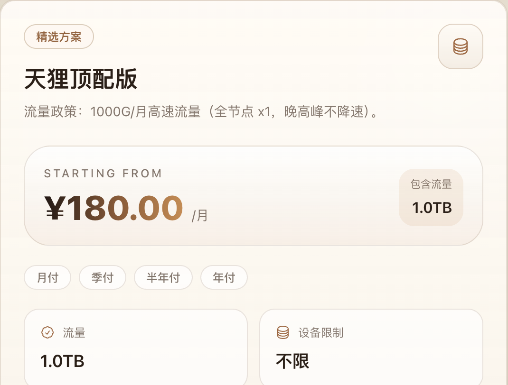</a>
  <figcaption>天狸后台套餐卡。¥180/月，卡片把每 30 天 1,000GB 显示为 1.0TB。</figcaption>
</figure>

天狸适合每月实际用量接近或超过 500GB 的用户，比如长期高码率播放、多台设备高频使用或大量上传下载。套餐卡写 **1.0TB**，官网套餐接口标明每 30 天 1,000GB。按 8 折估算，月付 ¥144。

| 付款周期 | 标价 | 按八折估算总价 | 折合每月 |
| --- | ---: | ---: | ---: |
| 月付 | ¥180 | ¥144 | ¥144 |
| 季付 | ¥535 | ¥428 | 约 ¥142.67 |
| 半年付 | ¥1,060 | ¥848 | 约 ¥141.33 |
| 年付 | ¥2,140 | ¥1,712 | 约 ¥142.67 |
| 两年付 | ¥4,300 | ¥3,440 | 约 ¥143.33 |
| 三年付 | ¥6,450 | ¥5,160 | 约 ¥143.33 |

天狸流量重置标价 ¥175/次，11 月 14 日验券报价 ¥140。若每次都能用券，半年付的月均成本在这档最低，两次半年付 ¥1,696，比年付少 ¥16。夜狸月付若经常加一次重置，两项券后合计 ¥148，已高于天狸月付的 ¥144。

## 快狸隐藏优惠码 sellvpn

在结算页输入 `sellvpn` 后，先核对套餐名称、付款周期和减免金额。年付会一次收取全年费用，购买流量重置包则是单笔支出。

1. 打开上面的快狸邀请链接，等线路检测跳转后注册或登录。
2. 进入「购买订阅」，选择套餐和付款周期。
3. 在结算页找到「有优惠券？」。在「输入优惠券代码」栏填入 **`sellvpn`**，点击下方的「兑换」。
4. 看到绿色的「优惠券：sellvpn」和「20% 折扣」后，核对订单总额再下单。

<figure class="kuaili-evidence">
  <a href="/images/kuaili/coupon-input-2026-11-14.webp">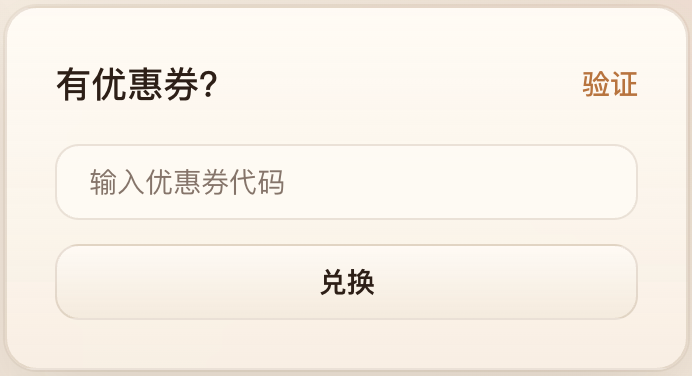</a>
  <figcaption>兑换前的结算页。在「输入优惠券代码」框填入 <code>sellvpn</code>，再点下方的「兑换」。</figcaption>
</figure>

### 11 月 14 日的三张验券截图 {#coupon-evidence}

<!-- #region kuaili-coupon -->
2026 年 11 月 14 日，`sellvpn` 在三笔结算中均减免 20%：月狸月付从 ¥15 降至 ¥12，森狸年付从 ¥120 降至 ¥96，天狸单次流量重置从 ¥175 降至 ¥140。截图记录的是付款前的报价。续费资格、同一账号可用次数和截止日期仍待核实。
<!-- #endregion kuaili-coupon -->

  <figure class="kuaili-evidence">
    <a href="/images/kuaili/coupon-monthly-2026-11-14.webp">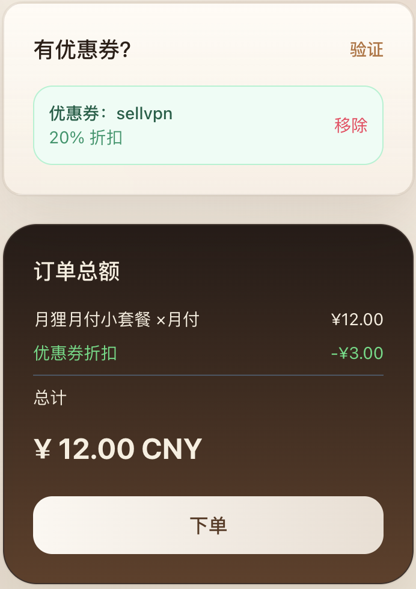</a>
    <figcaption>月狸月付，原价 ¥15，验券减 ¥3，应付 ¥12。</figcaption>
  </figure>
  <figure class="kuaili-evidence">
    <a href="/images/kuaili/coupon-annual-2026-11-14.webp">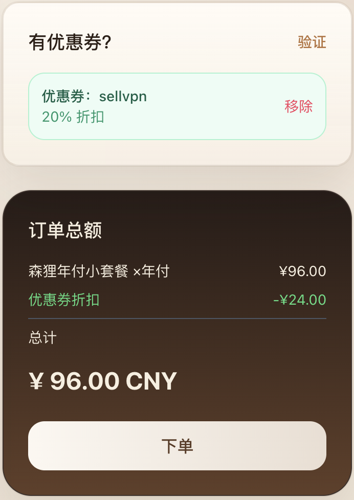</a>
    <figcaption>森狸年付，原价 ¥120，验券减 ¥24，应付 ¥96。</figcaption>
  </figure>
  <figure class="kuaili-evidence">
    <a href="/images/kuaili/coupon-reset-2026-11-14.webp">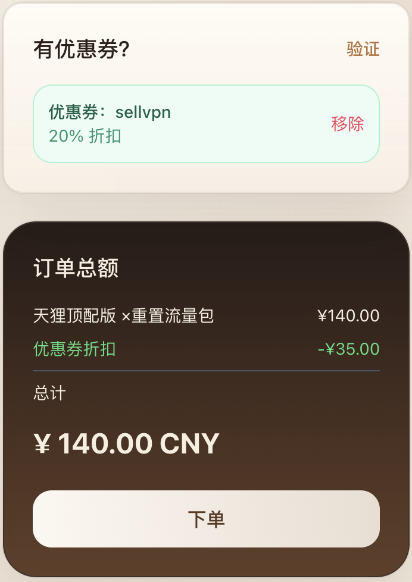</a>
    <figcaption>天狸流量重置包，原价 ¥175，验券减 ¥35，应付 ¥140。</figcaption>
  </figure>

## 快狸节点、测速与客户端

快狸套餐文案标注 IEPL 专线、全节点 1× 倍率、单节点峰值 2.5Gbps，服务商列出了 Netflix、Disney+、ChatGPT、TikTok 等支持项目。不同节点和时段的实际访问效果需要逐项测试。

11 月 14 日，天狸顶配版账号的节点页显示 **60 个在线、0 个离线**。截图里的日本节点标注 1×。在线数字反映当时的后台状态，实际连接速度取决于本地网络和节点负载。

<figure class="kuaili-evidence">
  <a href="/images/kuaili/nodes-2026-11-14.webp">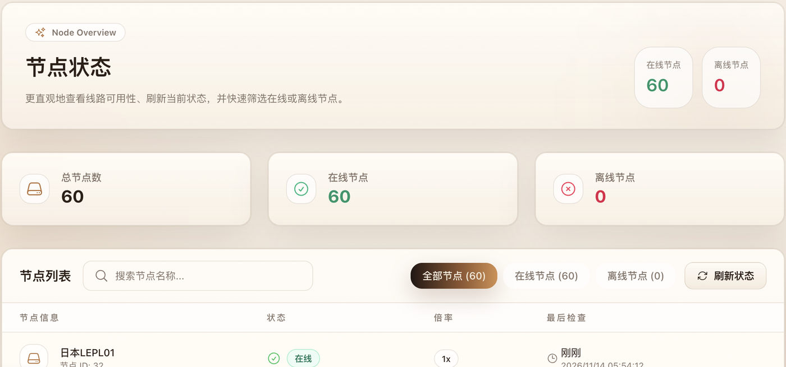</a>
  <figcaption>快狸节点状态页。上方是在线统计，下方是节点与倍率示例。</figcaption>
</figure>

| 第三方公开测速 | 测试条件 | 当次结果 |
| --- | --- | --- |
| 航线笔记，2026 年 10 月 9 日 19:40 | 港、日、新、美、台共 60 条，来源未注明运营商和时区 | 平均下载 64.81 MB/s，平均 HTTPS Ping 112.1 ms |
| 喵速快照，2026 年 8 月 11 日 19:52（北京时间） | 珠海联通 9Gbps，32 线程，50 条 VLESS 节点 | 香港 TLS RTT 约 98–202 ms，美国节点下载慢于同批香港节点 |

测速结果随线路、负载和运营商变化。要判断自己能否日常使用，可按[机场测速方法](/posts/airport-speed-test-method-2026/)固定两三个常用节点，分别在白天和晚高峰检查视频首开、延迟、丢包和断线重连。

后台列有 Windows、macOS、Android 的 klcloud 入口，iOS 指向第三方客户端 Nextin。帮助中心有 iOS 版 Clash Mi 的配置链接导入教程。依赖 Shadowrocket、其他 Clash 客户端或路由器的读者，可以先确认所需订阅格式和导入方式。

<figure class="kuaili-evidence">
  <a href="/images/kuaili/clients-2026-11-14.webp">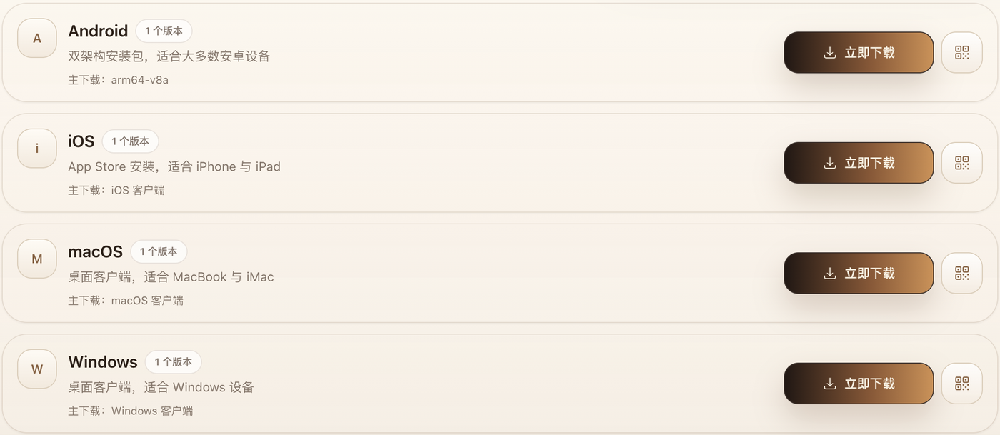</a>
  <figcaption>快狸仪表板的客户端入口，Android 下载项标注 arm64-v8a。</figcaption>
</figure>

## 常见问题

### 快狸是 8 元一个月还是 12 元一个月？

单买一个月，月狸 50GB 验券后 ¥12。森狸每 30 天 30GB，验券后需要一次付 ¥96，除以 12 才是月均 ¥8。

### 付款周期变长，流量会一次到账吗？

六档套餐都标注每 30 天刷新。比如灵狸年付仍是每 30 天 250GB。按年付标价 ¥415 估算，若结算时享受 8 折，一次应付 ¥332。

### 续费怎么用 sellvpn？

规划续费预算时先按套餐原价计算。进入自己的续费订单后，再核对页面是否接受 `sellvpn`、减免金额及应付总额。现有记录只覆盖[上述三笔报价](#coupon-evidence)。

[查看机场套餐对比](/posts/vpn-airport-ranking-2026/) · [查看机场优惠码表](/posts/airport-coupon-table/)

<a href="https://wudao01.kuailiaff.com/#/?code=ngH6LgR6" rel="sponsored nofollow noopener noreferrer" target="_blank">打开快狸邀请链接</a>
