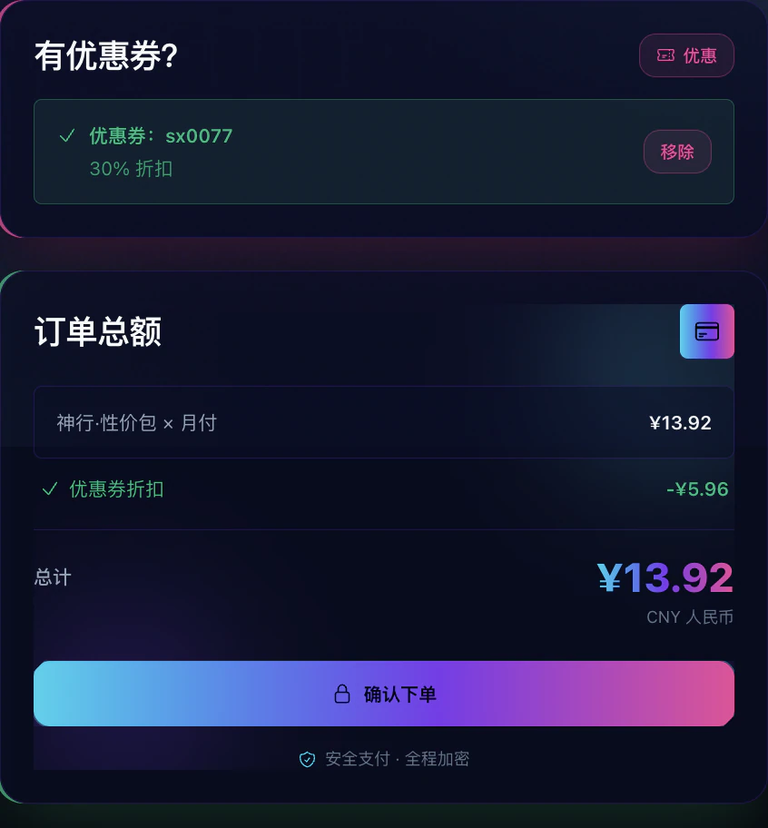
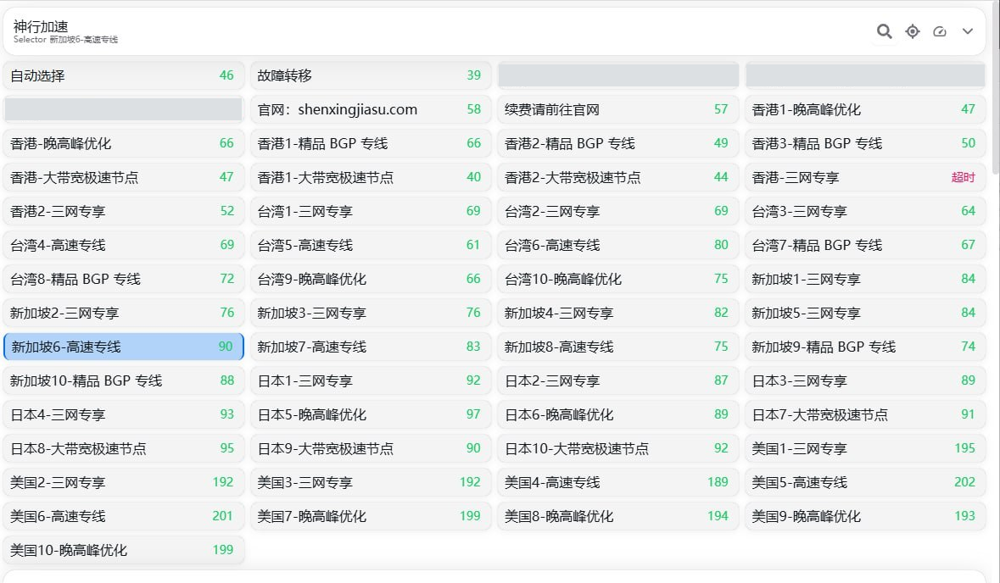

神行加速的性价包每月 **100GB**，原价 **¥19.88**，新客用 `sx0077` 后结算显示 **¥13.92**。年付特惠需一次付 **¥96**，每 30 天刷新 **60GB**。两档的月流量和付款门槛差别较大，先按实际用量挑档，再比较能否用券。

<!-- more -->

套餐、活动公告和节点分布取自机场测试 **2026 年 11 月 7 日**的后台核对底稿。本文所列优惠金额为验券时的订单报价。客户端延迟取自该底稿收录、分组标注为「神行加速」的用户截图。

## 神行加速套餐价格与流量

| 常规套餐 | 月流量 | 月付 | 季付 | 半年付 | 年付 |
| --- | ---: | ---: | ---: | ---: | ---: |
| 性价包 | 100GB | ¥19.88 | ¥52 | ¥108 | ¥212 |
| 基础包 | 150GB | ¥24.88 | ¥66 | ¥138 | ¥268 |
| 进阶包 | 300GB（套餐卡） | ¥38.88 | ¥108 | ¥216 | ¥384 |
| 尊享包 | 666GB（套餐卡） | ¥68.88 | ¥195 | ¥389 | ¥690 |

表内为各周期原价总额，常规套餐的说明写明流量从购买日开始按月重置。进阶包与尊享包的详情分别显示「40/月」与「72/月」，数字没有标明单位，也与套餐卡不一致。每月用量超过 150GB 时，可先请客服确认这两档实际到账的额度。

| 其他套餐 | 一次付款 | 流量规则 |
| --- | ---: | --- |
| 年付特惠版 | ¥96 | 每 30 天刷新 60GB |
| 不限时小包 | ¥99 | 合计 100GB，用完为止 |
| 不限时大包 | ¥298 | 合计 333GB，用完为止 |

年付特惠折合 **¥8/月**，而 100GB 性价包使用优惠码后的年付为 **¥148.40**，折合约 **¥12.37/月**。需要每月 100GB 时，首次可以先用月付验证自己常用的线路。平时只偶尔使用的读者，可按预计总用量和一次付款额比较两款不限时包。

## sx0077 优惠码与神行加速注册入口

<a href="https://wudaogang0.shenxingaff.com/#/?code=V3kBm6Cv" rel="sponsored nofollow">打开神行加速推广注册入口</a>。通过该链接购买，本站可能获得佣金。[联盟披露](/affiliate-disclosure/)

神行加速 11 月 3 日的后台公告提供新客 7 折码 `sx0077`。选好套餐和周期后，在结算页输入优惠码并兑换，确认应付总额。核对底稿记录了四款常规套餐各四个周期的验券结果，共 16 项。每档的月付报价如下。

| 套餐 | 月付原价 | 首单验券后应付 |
| --- | ---: | ---: |
| 性价包 | ¥19.88 | ¥13.92 |
| 基础包 | ¥24.88 | ¥17.42 |
| 进阶包 | ¥38.88 | ¥27.22 |
| 尊享包 | ¥68.88 | ¥48.22 |

年付特惠版和两款不限时包在核对时均未通过验券。年付特惠商品文案提到的券后折算月价，与结算结果有出入，预算按 ¥96 计算。其他套餐续费可先按原价估算，付款前再看账号中的实际报价。

## 神行加速节点分布与客户端延迟

后台列出 52 条在线记录，其中有两条用于提示官网和续费。其余 **50 条地区线路记录**平均分布于香港、台湾、日本、新加坡和美国，后台标注 **VLESS、1×**。下表仅统计节点返回的数字，不含自动选择、故障转移或提示行。

| 地区 | 有效读数 / 测试条目 | 客户端延迟 |
| --- | ---: | ---: |
| 香港 | 9/10 | 40–66 ms |
| 台湾 | 10/10 | 61–80 ms |
| 日本 | 10/10 | 87–97 ms |
| 新加坡 | 10/10 | 74–90 ms |
| 美国 | 10/10 | 189–202 ms |

香港有一条「三网专享」超时，其余 49 条地区线路返回延迟。截图未标出接入网络、探测目标或测试时间。下载截图的线路归属未能确认，下载速度仍需验证。使用自己常用的网络时，可优先测两个常用地区，再在晚高峰记录丢包和断线恢复情况。[机场测速方法](/posts/airport-speed-test-method-2026/)

## 神行加速的订阅怎么导入

后台列出 Android、Windows 和 macOS 的客户端入口。已有 Clash Verge、Clash Mi 或 Shadowrocket 时，先确认客户端版本支持 VLESS，再从后台导入对应格式的订阅。商家宣传的流媒体或 AI 访问范围需要在目标节点逐项验证，尤其是使用固定地区账号时。[Clash Verge 配置教程](/blog/clash-verge/) · [Clash Mi 配置教程](/blog/clashmi/) · [Shadowrocket 导入教程](/blog/shadowrocket/)

## 常见问题

### 神行加速 13.92 元可以用多久？

这是性价包用 `sx0077` 后的一次月付报价，包含该月的 100GB。活动针对新客，续费费用按账号的结算页面确认。

### 神行加速每月 60GB 套餐能用优惠码吗？

这是每 30 天刷新流量的年付特惠版，后台活动公告排除该套餐，验券时仍显示 ¥96。

### 神行加速限制同时在线设备吗？

商店套餐卡标注不限制同时在线设备数，同一订阅的设备共用套餐额度。购买前可以确认账号共享规则。

[查看机场官网入口汇总](/posts/airport-official-links-2026/) · [比较其他机场优惠码](/posts/airport-coupon-table/)
