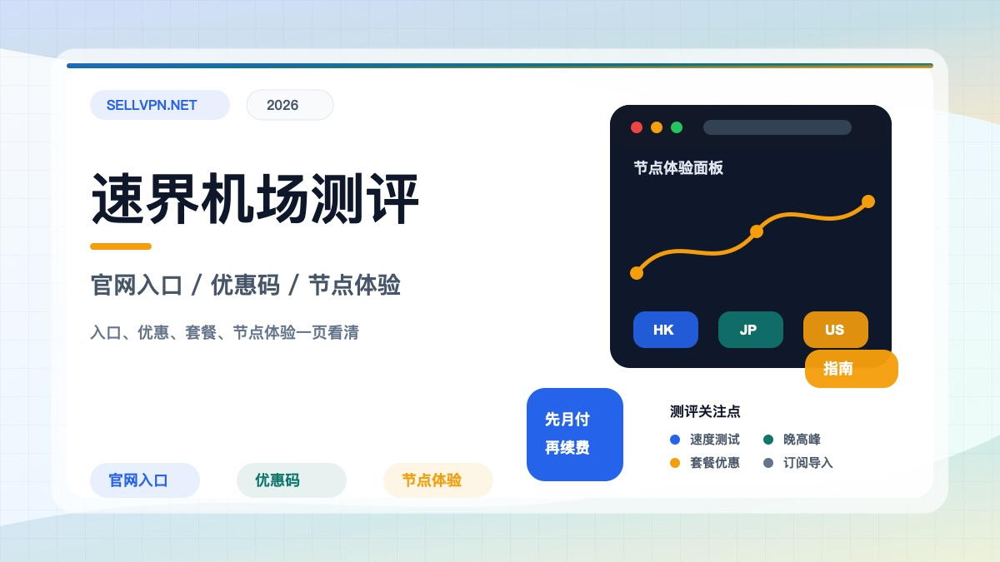

速界在 **2026 年 8 月 2 日**的后台提供两种低门槛月付。单月试用标价 **¥15，50GB**，极速版 **¥25，120GB**。第一次需要的流量在 50GB 以内，试用档可以少付 ¥10。如果要在同一个月用约 100GB，极速版的额度更合适。[机场测试的速界商店记录](https://jichangceshi.com/posts/sujie)

<!-- more -->

## 速界机场套餐价格

| 套餐 | 当时标价 | 每月额度 |
| --- | ---: | ---: |
| 单月试用 | ¥15/月 | 50GB |
| 极速版 | ¥25/月起 | 120GB |
| 超速版 | ¥50/月起 | 250GB |
| 光速版 | ¥100/月起 | 500GB |
| 跃迁版 | ¥200/月起 | 1000GB |
| 限时年付 | ¥90/年 | 商品卡 50GB，详情 45GB |

限时年付折合每月 ¥7.50，但首次付款是 ¥90。若每月实际用量接近 48GB，商品卡与详情相差的 5GB 会影响是否够用。详情另列 ¥10 的重置费用，购买前宜先确认开通额度和重置条件。

常规档也有周期价。例如超速版当时是 ¥50/月、¥142.50/季、¥270/半年，另列流量重置包 ¥45。按季付比按月买三次少 ¥7.50。8 月后台没有列出早期公开资料提到的 ¥5 全天不限量体验，这档的在售状态待确认。[速界各周期标价与年付额度差异](https://jichangceshi.com/posts/sujie)

## 节点状态、客户端和使用体验

同日后台显示 **72 个节点在线、0 个离线**，列表中可见香港、日本、新加坡、美国、德国、台湾等地区。IPLC、1 倍流量、最高 2.5Gbps 和不限设备均来自商品说明。后台在线数不能换算为实际下载速度，当次记录也没有丢包、晚高峰或逐项解锁结果。[速界节点与线路记录](https://jichangceshi.com/posts/sujie)

仪表盘提供 Android、iOS、macOS 和 Windows 的客户端下载入口，帮助中心分别列有这四个平台的教程。若需要在已有 Clash 客户端里管理多个订阅，应先确认商家能否提供兼容的通用订阅、链接的有效期限，以及是否允许定期更新。[Clash Mi 使用教程](/blog/clashmi/) · [科学上网新手入门指南](/posts/jieshao/)

## sujie888 优惠码与官网入口

机场测试 8 月 4 日整理的活动资料把 `sujie888` 列为首次 8 折。资料没有逐项列出试用档、限时年付及常规套餐的折后账单。选择周期后，可在结算页对照原价、优惠金额和最终应付。[机场测试的优惠资料说明](https://jichangceshi.com/posts/airport-compare)

> **联盟披露**　通过下方推广入口注册或购买，Sell VPN 可能获得佣金。[联盟披露](/affiliate-disclosure/)

[打开速界注册入口](https://wudaogang.speedworldaff.com/#/register?code=ITNrq6EJ) · [2026机场官网入口汇总](/posts/airport-official-links-2026/) · [机场优惠码汇总](/posts/airport-coupon-table/) · [机场推荐排行榜](/posts/vpn-airport-ranking-2026/)
