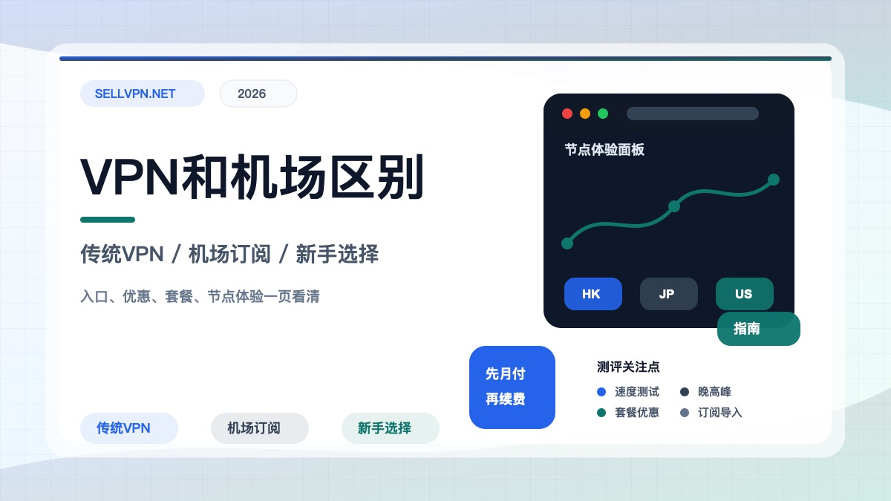

内容修订于 **2026年11月19日**。

VPN 是 Virtual Private Network（虚拟专用网络）的缩写，原本用于在设备与专用网络之间建立受控连接。普通消费者所说的“VPN服务”，通常是下载安装官方客户端、登录账号并选择服务器。机场通常提供可导入第三方客户端的代理节点订阅。两者的产品形态、配置方式和信任边界不同。

如果目的是在家打开公司的内部系统，先向 IT 取得公司指定的接入方式。如果手里已经有个人代理订阅链接，先查它支持哪个客户端。两个需求都可能让手机显示 VPN 图标，但接下来要做的事完全不同。

<!-- more -->

## 一句话结论

先看要连接的资源由谁管理，再选工具。

| 你手里的东西或遇到的问题 | 下一步 |
| --- | --- |
| 公司电脑能打开内部文档，在家打不开 | 向 IT 确认企业 VPN、账户和设备要求。消费 VPN 和个人代理订阅都无法授予公司内网权限 |
| 服务商发来一个订阅 URL，手机还没配置 | 在自己的服务后台确认支持的客户端。已购买的客户端和已购买的节点套餐通常分别提供 |
| 只想让工作 App 使用单位网络 | 询问管理员是否为该 App 配置了按 App 启用的 VPN。其他应用可能继续使用原网络 |
| 已有的网络能顺利完成所有任务 | 保留当前方案。出现具体的连接、速度或设备需求时，再决定是否需要购买服务 |

Apple 在平台安全指南中说明了按 App 启用 VPN、按需连接等部署方式。设备显示已连接时，某个 App 的流量如何处理，仍取决于单位或客户端配置。[Apple 的 VPN 安全说明](https://support.apple.com/zh-cn/guide/security/sec802e8ab55/web)

## VPN和机场区别速览

| 对比项 | 传统 VPN | 机场订阅 |
| --- | --- | --- |
| 使用方式 | 下载官方 App，登录后选择地区连接 | 购买套餐，复制订阅链接，导入代理客户端 |
| 客户端 | 通常使用服务商自带 App | 常用 Clash、Shadowrocket、Stash、V2RayN、sing-box |
| 节点数量 | 取决于服务商 App 内置地区 | 通常提供香港、日本、新加坡、美国等多地区节点 |
| 配置难度 | 更低，适合不想折腾的用户 | 稍高，需要理解订阅、节点和规则模式 |
| 价格结构 | 多为月付、年付会员 | 多为月付、季付、年付、按量或不限时流量包 |
| 速度体验 | 看服务商线路和所在地区 | 看线路质量、倍率、晚高峰和本地网络 |
| 灵活性 | 操作简单，但可调空间较少 | 节点切换、规则分流和客户端选择更灵活 |
| 适合人群 | 只想快速连接的新手 | 想兼顾速度、价格、节点地区和可玩性的用户 |

## VPN是什么？

VPN 是 Virtual Private Network 的缩写，中文是“虚拟专用网络”。例如，在家工作的员工使用公司认可的客户端和身份凭据，让去往内部系统的流量经过单位的 VPN 网关。在消费服务中，客户端通常由服务商提供，账号、服务器选择和技术支持也集中在同一个 App 里。

如果你需要保护某些应用的连接，先确认当前配置覆盖哪些应用，并核对服务商记录哪些数据、保留多久。付费价格和状态栏图标都无法回答这两个问题。

## 机场是什么？

机场是中文互联网里的俗称，通常指提供 Shadowsocks、V2Ray、Trojan、Hysteria、Reality 等代理节点的服务商。用户购买套餐后，会得到一个订阅链接，把它导入 Clash、Shadowrocket、Stash、V2RayN、sing-box 等客户端后使用。

机场的特点是节点更多、线路更灵活，常见地区包括香港、日本、新加坡、台湾、美国等。不同机场还会提供普通中转、IPLC、IEPL、BGP、家宽等线路口径。

适合机场订阅的场景：

- 想对比多个节点地区
- 希望手机、电脑、平板分设备配置
- 想用规则模式，让不同网站自动走不同线路

## 新手怎么选？

如果已有服务，先看供应方给了什么。只有用户名和密码时，到服务商自己的帮助页找支持的登录方式。拿到订阅 URL 时，查该套餐支持哪些客户端，以及手机和电脑能否共用。有些套餐允许两种方式登录或导入，以后台说明为准。

需要配置订阅的用户可以直接按设备找对应步骤。[Clash Mi 使用教程](/blog/clashmi/) · [Clash Verge 桌面教程](/blog/clash-verge/) · [Shadowrocket 小火箭教程](/blog/shadowrocket/)

## 怎样比较两个套餐的实际成本？

假设甲套餐每月 20 元、100 GB，常用节点按 2 倍倍率扣量。如果计费规则写明传输 1 GB 会扣掉 2 GB，那么全程使用该节点时，可实际传输约 50 GB。乙套餐每月 18 元、60 GB，常用节点按 1 倍计费，则可传输约 60 GB。这组假设下，标注流量较少的乙套餐既便宜，也更够用。

比较真实套餐时，把示例里的月费、流量和倍率换成结算页的数字，再核对重置日期。一次性流量包还要查看有效期。两个设备一起使用时，要另外确认“同时在线设备数”的计算规则。

## 购买前检查清单

下单前建议逐项确认：

- 是否支持月付或体验套餐
- 优惠码是否在结算页生效
- 套餐流量是每月重置还是一次性流量
- 热门节点是否有 2 倍、3 倍倍率
- 是否支持你正在使用的客户端
- 是否能导出订阅链接
- 是否有常用地区节点
- 是否提供公告、教程和工单
- 是否限制同时在线设备数量
- 是否有清楚的退款或售后说明

优惠码可以查看 [机场优惠码汇总](/posts/airport-coupon-table/)。新手建议先短周期测试，再决定是否长期续费。

## 常见问题

### VPN和机场哪个更稳定？

不能只按名称判断。稳定性主要看线路质量、节点负载、晚高峰表现、服务商维护能力和你的本地网络环境。最稳妥的方法是先月付测试。

### 机场是不是VPN？

“VPN”描述的是虚拟专用网络技术。“机场”是对提供代理节点订阅的一类服务商的俗称。在 iPhone 上，代理客户端也可能借用系统的 VPN 配置来处理流量，因此两种产品都可能触发同一种系统提示。

### 新手应该先买哪个？

服务商自带 App 可以省去导入步骤。若希望复用现有代理客户端，先查套餐能否导出兼容订阅。初次购买可用短周期套餐在自己的设备上验证。

### 机场需要自己搭建服务器吗？

不需要。机场是服务商已经搭好的节点订阅，你只需要购买套餐、复制订阅链接、导入客户端即可。自建节点是另一条路线，技术门槛更高。

### 免费VPN可以用吗？

先核对运营者、隐私条款、流量上限和收费方式，再判断免费档是否够用。对公司设备或敏感业务，按单位允许的服务清单选择。

## 推荐阅读

- [2026机场推荐与VPN推荐排行榜](/posts/vpn-airport-ranking-2026/)
- [各大机场优惠码汇总](/posts/airport-coupon-table/)
- [2026便宜机场推荐与低价VPN](/posts/cheap-airport-ranking-2026/)
- [使用 ChatGPT 时怎样排查网络故障](/posts/chatgpt-airport-ranking-2026/)
- [2026流媒体机场推荐与VPN节点选择](/posts/streaming-airport-ranking-2026/)
- [机场测速怎么测才准确？](/posts/airport-speed-test-method-2026/)
- [机场防跑路与避坑指南](/posts/airport-risk-checklist-2026/)
- [科学上网是什么？VPN、机场、翻墙工具与软路由区别详解](/posts/jieshao/)
- [加速器、VPN、梯子、翻墙有什么区别？](/posts/accelerator-vpn-ladder-difference/)
